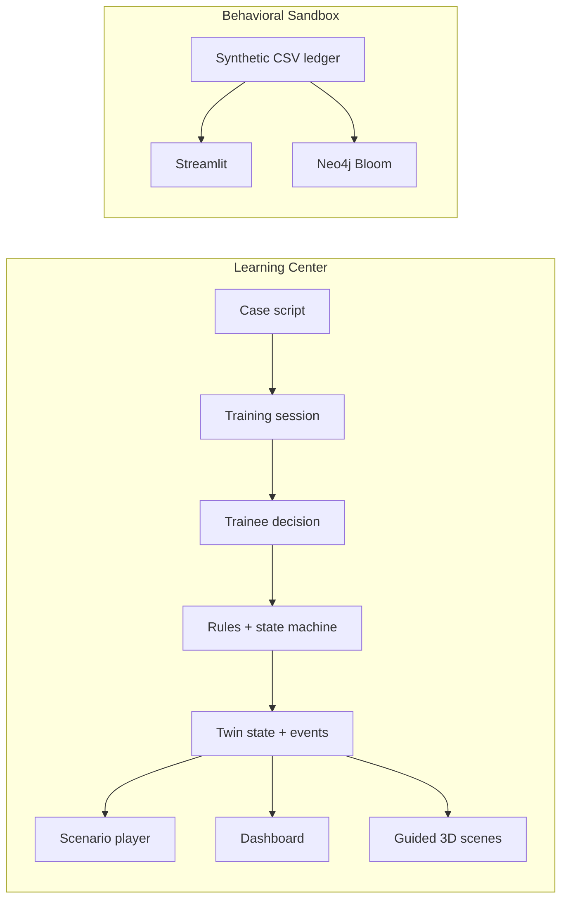

# TwinAML

TwinAML is a proprietary COMP3424 course demo for AML simulation training. It is not a bank system or an open-source release.

- Repository: <https://github.com/innalhy/aml-twin>
- Learning Center: <https://dev-amltwin.spectrumvps.tech/>
- Behavioral Sandbox: <https://amlsim.spectrumvps.tech>

The demo has two independent parts:

| Part | Role |
| --- | --- |
| **Learning Center** | Scripted case sessions, trainee decisions, twin state, events, evidence, a dashboard, and an in-browser 3D Simulation Center. |
| **Behavioral Sandbox** | Streamlit/Neo4j classroom exercise for a synthetic ledger, amount-line alerts, and a payment network. |

They do not share a store or a live bank connection. Rules and the state machine decide compliance outcomes (`rules-before-AI`). A language model must not set a case outcome at runtime. Human overrides are stored as events.

## Learning Center

The development site is at <https://dev-amltwin.spectrumvps.tech/> (`/simulations`). It declares `twinaml-environment=development`, `twinaml-release=20261109T064146Z`, and `robots=noindex`.

The live bundle is ahead of this `main` tree:

| Piece | Live VPS | This branch |
| --- | --- | --- |
| Web | React 19/Vite SPA; lazy-loads `SceneViewport` and `TwinPlatform` | [`frontend/`](frontend/) contains the case list, player, and dashboard only |
| 3D | Three.js scenes on `/simulations` | Not included; source lives outside this branch |
| API | `GET /api/cases`, `/api/sessions`, `/api/case-sessions`, `/api/twin`, `/api/account`, and simulation routes | [`backend/`](backend/) declares `GET /cases`, `GET /health`, session routes, and evidence |
| Account | Clerk appears in the bundle; account API reports auth disabled | No auth module is included |
| Twin Platform | `/twin` and `/operations` include `TwinPlatform` | Not included; no runtime bank or Streamlit/Neo4j connection |

Release `20261109T064146Z` is ahead of this `main` tree. The VPS and repository gap is described below and in [`docs/deploy-vps.md`](docs/deploy-vps.md).

## Cases

[`data/cases/index.json`](data/cases/index.json) names **13** synthetic scripts:

- 11 from the Phase 1 library: `deepfake-hk-001` and ten `public_record_inspired` scripts.
- `starlight-onboard-001` (`synthetic_course`).
- `alert-triage-shift-001` (`course_example`) has a 41 KB alert dossier.

Every customer, account, and amount is synthetic. Public-reporting references and the disclaimer are in [`data/cases/README.md`](data/cases/README.md). The table below omits the leading `hk-` on local case IDs except for `deepfake-hk-001`.

| Case ID | Theme |
| --- | --- |
| `deepfake-hk-001` | Video-KYC deepfake executive impersonation |
| `daybreak-tbml-001` | TBML, shells, fake jewellery/diamond exports |
| `mule-rent-001` | Account rental |
| `wiseword-amlmonth-001` | One mule across several typologies |
| `justicegate-crypto-001` | Cash and crypto OTC |
| `greythunder-mule-001` | Mule cluster |
| `crossborder-tel-001` | Cross-border phone-fraud corridor |
| `kol-mgmt-001` | KOL/influencer front |
| `triad-cashflow-001` | Organised-crime cashflow |
| `ia-fwd-controls-001` | Synthetic insurer controls |
| `hkma-cdd-001` | Synthetic bank CDD, monitoring, and STR |
| `starlight-onboard-001` | Hidden beneficial ownership |
| `alert-triage-shift-001` | One monitoring shift, six alerts |

The live `GET /api/cases` list is also 13 cases across 11 workflows, but it is not this branch's index:

`project-meridian-001`, `deepfake-001`, `mule-mixer-001`, `daybreak-tbml-001`, `crossborder-tel-001`, `mule-rent-001`, `greythunder-mule-001`, `justicegate-crypto-001`, `kol-mgmt-001`, `wiseword-amlmonth-001`, `triad-cashflow-001`, `insurer-controls-001`, and `bank-cdd-001`.

Workflow 3 (synthetic identity) has no live case or script. `bank-cdd-001` is not in `data/cases/`; the 3D guided scenes use `bank-cdd-001` and `mule-rent-001`.

### Case flows

English Mermaid teaching diagrams are in [`data/case-flow/`](data/case-flow/). Playable scripts remain in [`data/cases/`](data/cases/).

| Topic | Flow | Playable scripts |
| --- | --- | --- |
| Deepfake executive impersonation | [English](data/case-flow/01-deepfake-executive-impersonation.en.md) | `deepfake-hk-001` |
| Mule accounts and crypto mixers | [English](data/case-flow/02-crypto-mixers-mule-accounts.en.md) | Mule/crypto scripts |
| Synthetic identity | [English](data/case-flow/03-synthetic-identity-fraud.en.md) | None |
| Trade-based money laundering | [English](data/case-flow/04-trade-based-money-laundering.en.md) | `daybreak-tbml-001` |
| Cross-border phone fraud | [English](data/case-flow/05-crossborder-phone-fraud.en.md) | `crossborder-tel-001` |
| Account rental and mule clusters | [English](data/case-flow/06-account-rental-mule-clusters.en.md) | `mule-rent-001`, `greythunder-mule-001` |
| Cash and crypto OTC | [English](data/case-flow/07-cash-crypto-otc.en.md) | `justicegate-crypto-001` |
| KOL management front | [English](data/case-flow/08-kol-management-front.en.md) | `kol-mgmt-001` |
| Multi-typology mule account | [English](data/case-flow/09-multi-typology-mule.en.md) | `wiseword-amlmonth-001` |
| Organised-crime cashflow | [English](data/case-flow/10-organised-crime-cashflow.en.md) | `triad-cashflow-001` |
| Insurer and bank control gaps | [English](data/case-flow/11-control-gaps.en.md) | `ia-fwd-controls-001`, `hkma-cdd-001` |

The mixer page discusses four nearby scripts but is a teaching diagram, not a line-by-line script map. `starlight-onboard-001` and `alert-triage-shift-001` are playable without case-flow pages.

## Architecture



| Piece | Location | Role |
| --- | --- | --- |
| Learning Center API | [`backend/`](backend/) | Cases, sessions, decisions, twin state, events, evidence |
| Learning Center web | [`frontend/`](frontend/) | Static case list, player, and dashboard |
| 3D Simulation Center | Live `/simulations` | Three browser scenes using Three.js; source absent from this branch |
| Behavioral Sandbox | [`demo/neo4j/`](demo/neo4j/) | Streamlit, bundled CSV, rules/network views, Cypher, Bloom notes |
| Graph view | Presenter machine | Neo4j 5/Bloom; not a VPS process or cloud Bloom plugin |
| Legacy scaffold | [`workers/`](workers/) | Optional Cloudflare Worker scaffold; not the demo path |

The web app is not a private copy of the case world. It renders backend state. Compliance outcomes come from rules and `twin_patch`/`choices[].effects`; patch behavior is documented in [`docs/effects.md`](docs/effects.md). The model does not parse human-readable `when` text or set outcomes.

### Learning Center API

This branch declares:

- `GET /health`
- `GET /cases`
- `POST /sessions`
- `GET /sessions`
- `GET /sessions/{id}`
- `POST /sessions/{id}/decisions`
- `GET /sessions/{id}/evidence`

`GET /health` returns `{"status":"ok","service":"twinaml-api"}`. Session data is SQLite in `data/local/sessions.sqlite` by default; override with `TWINAML_SESSIONS_DB`. Evidence summarizes one run in [`docs/audit-evidence.md`](docs/audit-evidence.md).

The live VPS has additional `/api/` routes that are not in this branch. The current routes and source gaps are tracked in [`docs/architecture.md`](docs/architecture.md).

## VPS and 3D

The Learning Center runs on a rented Linux VPS. nginx or Caddy serves the static React build and forwards API traffic to FastAPI on `127.0.0.1:8000`. Deployment instructions are in [`docs/deploy-vps.md`](docs/deploy-vps.md).

| Piece | VPS behavior | Branch behavior |
| --- | --- | --- |
| Web | React SPA with `SceneViewport` and `TwinPlatform` chunks | React/Vite only; no `three` dependency |
| Session API | `/api/cases`, `/api/sessions`, `/api/case-sessions` | Unprefixed routes listed above |
| Session store | SQLite through Python `sqlite3` | `backend/app/sessions.py` |
| AML Process Twin | `/api/twin` reports enabled | `TwinPlatform` source absent |
| Account | `/api/account` returns disabled/unconfigured | No auth module |

The live `/simulations` page has three interactive Three.js scenes. Use drag/pinch/zoom and arrow keys to navigate; hotspot pins open stations.

| Scene | Room | Behavior |
| --- | --- | --- |
| Client onboarding and CDD | Private banking office | Guided `bank-cdd-001` |
| Suspicious activity review | Retail branch | Guided `mule-rent-001` |
| Transaction monitoring | Operations room | Timed simulation; calls extra `/api/aml-simulations` routes |

A WebGL fallback offers stations below instead of the 3D canvas. These scenes are browser training rooms, not a geometric workplace twin, Unity WebGL build, or Behavioral Sandbox. Rooms use `BoxGeometry`, `PlaneGeometry`, and other Three.js primitives; no `.glb` or `.gltf` files are used.

Unity, Unreal, Omniverse, and FlexSim are not current demo paths. The Unity Editor project exists only on the [`unity` branch](https://github.com/innalhy/aml-twin/tree/unity) and is absent from this branch.

## Digital-twin scope

The course interpretation is in [`docs/comp3424-mapping.md`](docs/comp3424-mapping.md).

| Type or capability | TwinAML scope | Implementation | Outside scope |
| --- | --- | --- | --- |
| **Scripted digital mirror — DT Level 1** | One synthetic AML investigation containing customers, KYC signals, accounts, transactions, and risk flags | `initial_twin_state` and nodes in [`data/cases/`](data/cases/); FastAPI opens sessions and records events | No live physical system or sensor feed |
| **Behavioral/transactional twin — DT Level 2/3** | One synthetic week of transactions tested by rule changes and viewed as a network | [`demo/neo4j/`](demo/neo4j/) Streamlit amount-line controls; Neo4j Bloom graph | No live bank, ML score, or production data |
| **Mirroring** | Offline representation of the current case or ledger state | Case scripts and bundled CSV | No direct synchronization with real-world assets |
| **Shadowing** | The twin follows trainee decisions or sandbox control changes | Session state/events update the dashboard; the amount line updates alert counts | No bidirectional control or automatic action on a real system |
| **Threading** | A replayable record of state, decisions, overrides, and outcomes | Ordered session events and `GET /sessions/{id}/evidence` | No cross-system data lake or live audit integration |
| **3D browser twin presentation** | Interactive AML training rooms and guided/timed scenes | Live Three.js `SceneViewport` on `/simulations` | Not a geometric workplace twin, Unity build, or virtual factory |
| **Rules-before-AI** | Deterministic compliance and disposition logic | Script rules and state machine apply patches/effects | An LLM cannot set the score or disposition; no autonomous agent |

## Tech stack

| Layer | Technology | Role |
| --- | --- | --- |
| Learning Center API | FastAPI, Python stdlib SQLite | `backend/app/` state machine and sessions |
| Learning Center web | React 19, Vite, TypeScript | Static client in `frontend/` |
| 3D (live VPS) | Three.js, React | `/simulations`; absent from this branch |
| Behavioral Sandbox | Streamlit, pandas, networkx, pyvis | Bundled CSV and detection exercise |
| Graph | Neo4j 5, Bloom | Local presenter view |
| Scripts | JSON schema 0.1 | 13 scripts, effect keys, and alert dossier |
| Deploy | Linux VPS, nginx/Caddy, HTTPS | Static `frontend/dist` + FastAPI |
| Legacy | Cloudflare Worker scaffold | `workers/api/`; not the demo |

`packages/schemas/script.schema.json` freezes the script contract. [`docs/effects.md`](docs/effects.md) documents patch keys. The alert dossier uses `packages/schemas/alerts.schema.json`.

Out of scope unless explicitly requested: Docker, Kubernetes, Kafka, FlexSim, PostgreSQL, Redis, MySQL, microservices, live bank connections, billing, and session-time video synthesis.

## Repository layout

```text
backend/       Learning Center FastAPI
frontend/      Learning Center React/Vite client
demo/neo4j/    Behavioral Sandbox
data/cases/    playable scripts and 13-case index
data/case-flow/ English Mermaid review flows
docs/          architecture, effects, deployment, and course notes
packages/      script and alert JSON schemas
scripts/       validation and path tests
workers/       legacy Worker scaffold
mindmap/       course sketch; not the build contract
```

Tracked: `frontend/package-lock.json`, `workers/api/package-lock.json`.

Ignored: `frontend/dist/`, `node_modules/`, `.venv/`, `.env`, `data/local/sessions.sqlite`, and media binaries. Only `data/media/.gitkeep` is tracked. A script may reference `media_ref`, but missing media remains a visible fallback.

The folder `unity/` is not on this branch. The Editor project remains on branch `unity`.

## Run locally

### Learning Center API

```bash
cd backend
python3 -m venv .venv
source .venv/bin/activate
pip install -r requirements.txt
uvicorn app.main:app --reload --port 8000
```

Check `http://127.0.0.1:8000/health`. Start a session with `{"case_id":"deepfake-hk-001"}` through `POST /sessions`.

### Learning Center web

```bash
cd frontend
npm install
npm run dev
```

Open <http://127.0.0.1:5173>. Vite proxies `/health`, `/cases`, and `/sessions` to port 8000. Build with `npm run build`; it typechecks and writes `dist/`, which should not be committed.

### Behavioral Sandbox

Use Python 3.11+:

```bash
cd demo/neo4j
python3 -m venv .venv
source .venv/bin/activate
pip install -r requirements.txt
python -m streamlit run app.py --server.address 127.0.0.1 --server.port 8501
```

Open <http://127.0.0.1:8501>. Streamlit reads the bundled CSV. Neo4j/Bloom setup is optional and local.

### Validation

From the repository root:

```bash
node scripts/validate-cases.mjs
node scripts/unity-room-paths.test.mjs
```

API tests:

```bash
cd backend
source .venv/bin/activate
PYTHONPATH=. python -m unittest discover -s tests -v
```

Sandbox tests:

```bash
cd demo/neo4j
source .venv/bin/activate
PYTHONPATH=. python -m unittest discover -s tests -v
```

## Deploy

The Learning Center is deployed as static `frontend/dist/` plus FastAPI behind nginx or Caddy with HTTPS. Node 22 matches CI. The public Learning Center URL is <https://dev-amltwin.spectrumvps.tech/>.

The VPS API also has live `/api/` routes not present in `backend/app/`. Reverse-proxy only this branch's `/health`, `/cases`, and `/sessions` unless adding the live routes explicitly.

Streamlit can run on the VPS or presenter laptop:

```bash
cd demo/neo4j
source .venv/bin/activate
python -m streamlit run app.py --server.address 127.0.0.1 --server.port 8501
```

No public Streamlit URL is published. An existing machine proxy may forward Caddy or nginx to `127.0.0.1:8501`. Keep Streamlit on its own port and rule; it is not part of the Learning Center session store.

Neo4j Bloom remains on the presenter machine:

1. Copy the CSV files into the Neo4j import folder.
2. Run [`demo/neo4j/cypher/load_twin.cypher`](demo/neo4j/cypher/load_twin.cypher).
3. Run the searches in [`demo/neo4j/cypher/stories.cypher`](demo/neo4j/cypher/stories.cypher).
4. Use [`demo/neo4j/cypher/bloom_perspective.md`](demo/neo4j/cypher/bloom_perspective.md) for graph styling.

Do not commit `.env`, database passwords, certificates, or private keys.

## Implementation status

| Phase | Status | Current implementation |
| --- | --- | --- |
| Phase 1 | Done | Learning Center scripts, state machine, sessions, player, events, dashboard, evidence |
| Phase 2 | Replaced | Behavioral Sandbox amount line and payment network |
| Phase 3 | Replaced | Classroom sandbox; no ML judge, bank connector, or Unity client |

P1-S1 through P1-S8 are complete:

| Slice | Done when |
| --- | --- |
| P1-S1 | Script contract frozen; see [`docs/effects.md`](docs/effects.md) |
| P1-S2 | State machine passes `backend/tests/test_machine.py` |
| P1-S3 | Session store/API passes POST and GET routes |
| P1-S4 | Scenario player lists indexed scripts and handles missing media |
| P1-S5 | Ordered event log and `poor_path` teaching score |
| P1-S6 | Dashboard reads the session API |
| P1-S7 | VPS deploy checklist in [`docs/deploy-vps.md`](docs/deploy-vps.md) |
| P1-S8 | README and [`docs/audit-evidence.md`](docs/audit-evidence.md) |

The older engineering checklists in [`docs/phases/PHASE2.md`](docs/phases/PHASE2.md) and [`docs/phases/PHASE3.md`](docs/phases/PHASE3.md) are not open work. Synthetic identity remains absent from `data/cases/`.

## Agent rules

The full working agreement is [`AGENTS.md`](AGENTS.md).

1. Change one small slice at a time and describe what a trainee or reviewer can now run.
2. Keep one React/Vite client and one FastAPI VPS API. Keep the live 3D source out of this branch. Keep Neo4j and Streamlit in `demo/neo4j/`.
3. Leave Docker, Kubernetes, Kafka, FlexSim, PostgreSQL, Redis, MySQL, and microservices out unless explicitly requested.
4. Keep course and UI terminology in English.
5. Store Learning Center state and events only in the backend; do not create a private client-side twin.
6. Let rules decide outcomes. Models may explain or assist after rules fire.
7. Never commit secrets or large media.
8. If a script shape changes, validate every example against `packages/schemas/script.schema.json` and update the schema/docs.

## License

The TwinAML platform idea is owned by [@innalhy](https://github.com/innalhy), with technical support by [@SpectrumTantrum](https://github.com/SpectrumTantrum). Repository contents are proprietary; all rights reserved.

This is a COMP3424 course demo, not an OSI-licensed project. Redistribution or commercial use requires the owner's permission.
