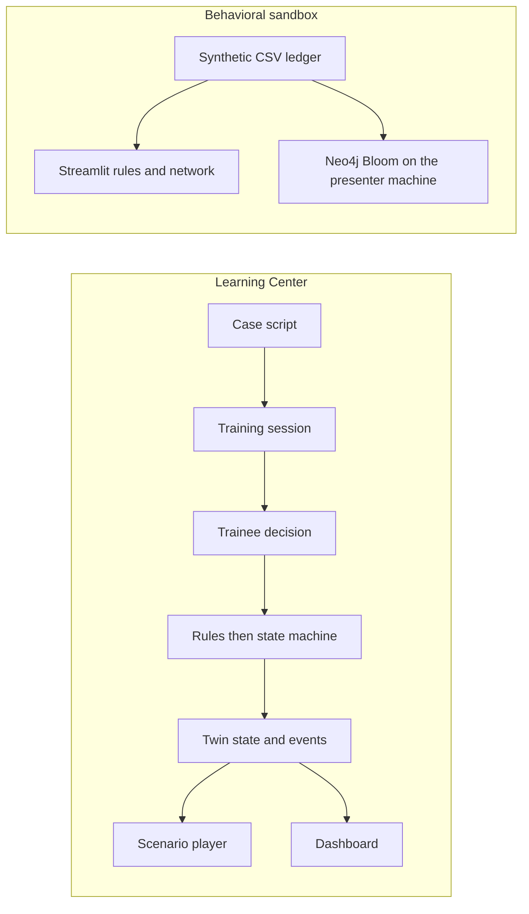

# TwinAML

## What this project is for

TwinAML is a COMP3424 course demo of a digital twin for AML simulation training. The platform idea is proprietary. This tree is a classroom demo. It is not a bank production system, and it is not an open-source release.

The classroom demo on this branch (`main`) has two pieces.

The **Learning Center** is the web training shell. FastAPI in `backend/` loads a case script, opens a session, applies a choice, and stores the twin and the events. The Vite app in `frontend/` is the case list, the scenario player, and the dashboard. The player and the dashboard both read that session. The page title in the app is TwinAML. This README uses “Learning Center” for that shell.

The **behavioral sandbox** in [`demo/neo4j/`](demo/neo4j/README.md) is the other classroom piece. It loads a synthetic ledger, moves an amount line, and draws the same payments as a network. Neo4j Bloom is the graph view of that ledger.

A trainee picks a script by `case_id` and decides inside it. Rules in the script decide compliance outcomes (rules-before-AI). A language model, if one is added later, may explain a decision only after those rules have fired. A human override must be stored as an event.

## Cases and themes

[`data/cases/index.json`](data/cases/index.json) names **13** synthetic scripts. The Phase 1 library in the phase plan is the first **11**: `deepfake-hk-001` plus the ten `public_record_inspired` scripts. The Learning Center can also start `hk-starlight-onboard-001` (`synthetic_course`) and `alert-triage-shift-001` (`course_example`). Every customer, account, and amount in them is synthetic.

The id the API accepts is the `case_id` in the index and in the script file. The disclaimer, and the public-reporting notes the scripts were inspired by, are in [`data/cases/README.md`](data/cases/README.md). The page chrome is English. Prompt text in most scripts is Traditional Chinese. `alert-triage-shift-001` is English.

| case_id | Theme |
| --- | --- |
| `deepfake-hk-001` | Original course example: video-KYC deepfake |
| `hk-daybreak-tbml-001` | TBML / shell / fake jewellery-diamond exports |
| `hk-mule-rent-001` | Account rental |
| `hk-wiseword-amlmonth-001` | One mule, several typologies |
| `hk-justicegate-crypto-001` | Cash + crypto OTC |
| `hk-greythunder-mule-001` | Mule cluster |
| `hk-crossborder-tel-001` | Cross-border phone-fraud corridor |
| `hk-kol-mgmt-001` | KOL / influencer front |
| `hk-triad-cashflow-001` | Organised-crime cashflow indicators |
| `hk-ia-fwd-controls-001` | Insurer controls (synthetic insurer) |
| `hk-hkma-cdd-001` | Bank CDD / monitoring / STR (synthetic bank) |
| `hk-starlight-onboard-001` | Company onboarding, hidden beneficial owner |
| `alert-triage-shift-001` | One monitoring shift, six synthetic alerts |

## Case flows

English review pages live in [`data/case-flow/`](data/case-flow/). Each page is a Mermaid teaching diagram for human review. The playable scripts stay in [`data/cases/`](data/cases/). `hk-starlight-onboard-001` and `alert-triage-shift-001` are playable and have no case-flow page.

| Case | English flow | Playable script |
| --- | --- | --- |
| Deepfake executive impersonation | [English](data/case-flow/01-deepfake-executive-impersonation.en.md) | `deepfake-hk-001` |
| Mule accounts and a crypto mixer | [English](data/case-flow/02-crypto-mixers-mule-accounts.en.md) | `hk-mule-rent-001`, `hk-wiseword-amlmonth-001`, `hk-greythunder-mule-001`, `hk-justicegate-crypto-001` |
| Synthetic identity fraud | [English](data/case-flow/03-synthetic-identity-fraud.en.md) | No playable script in the library. |
| Trade-based money laundering | [English](data/case-flow/04-trade-based-money-laundering.en.md) | `hk-daybreak-tbml-001` |
| Cross-border phone-fraud corridor | [English](data/case-flow/05-crossborder-phone-fraud.en.md) | `hk-crossborder-tel-001` |
| Account rental and mule clusters | [English](data/case-flow/06-account-rental-mule-clusters.en.md) | `hk-mule-rent-001`, `hk-greythunder-mule-001` |
| Cash and crypto OTC cashing-out | [English](data/case-flow/07-cash-crypto-otc.en.md) | `hk-justicegate-crypto-001` |
| KOL management front company | [English](data/case-flow/08-kol-management-front.en.md) | `hk-kol-mgmt-001` |
| Multi-typology mule account | [English](data/case-flow/09-multi-typology-mule.en.md) | `hk-wiseword-amlmonth-001` |
| Organised-crime cashflow | [English](data/case-flow/10-organised-crime-cashflow.en.md) | `hk-triad-cashflow-001` |
| Insurer and bank control gaps | [English](data/case-flow/11-control-gaps.en.md) | `hk-ia-fwd-controls-001`, `hk-hkma-cdd-001` |

The mixer page names those four scripts as nearby playable scripts. The page is a teaching diagram. It is not a line-by-line map of those scripts. The synthetic-identity page has no matching file under `data/cases/`.

## Architecture

One Learning Center API and one web client, plus the behavioral sandbox. The Learning Center deploy is a self-hosted Linux VPS. The sandbox can run on the same machine or on a presenter's laptop. Bloom stays on the presenter's machine.



| Piece | Where | Role |
| --- | --- | --- |
| Learning Center API | `backend/` | FastAPI. Health, case list, sessions, decisions, the twin state machine, events, and the evidence card. A Node/Hono process may serve the same routes later. |
| Learning Center web | `frontend/` | React + Vite + TypeScript. Static files on the VPS. Case list, scenario player, and dashboard. Both read the same twin. |
| Behavioral sandbox | `demo/neo4j/` | Streamlit app, bundled CSV ledger, Cypher load scripts, and Bloom notes. Amount-line alerts and a network reading of the same payments. |
| Graph view | Presenter's machine | Neo4j Desktop or a local Neo4j 5, opened in Bloom. Same ledger as the CSV. This is not a process on the VPS. |
| Legacy scaffold | `workers/api` | Cloudflare Worker (Hono) plus Wrangler config. `GET /health` only. Left in the tree. Not the COMP3424 demo deploy. |

The web app does not keep a private copy of the case world. Compliance outcomes in a script come from the rules and from the state machine that applies `twin_patch` and `choices[].effects`. How those patches apply is in [`docs/effects.md`](docs/effects.md). The session routes are `GET /cases`, `POST /sessions`, `GET /sessions`, `GET /sessions/{id}`, `POST /sessions/{id}/decisions`, and `GET /sessions/{id}/evidence`. `GET /health` stays. A longer note on that run is in [`docs/architecture.md`](docs/architecture.md). The course terms — mirroring, shadowing, threading, DT Level 1, DT Level 2, rules-before-AI — are mapped in [`docs/comp3424-mapping.md`](docs/comp3424-mapping.md).

`workers/api` can answer the same health check only. `GET /sessions/{id}/evidence` summarises one Learning Center run for [`docs/audit-evidence.md`](docs/audit-evidence.md).

An Editor project lives only on branch [`unity`](https://github.com/innalhy/aml-twin/tree/unity). This branch does not contain `unity/`. That project is outside the current COMP3424 demo path.

The sandbox does not write the Learning Center session store. Its own note is [`demo/neo4j/README.md`](demo/neo4j/README.md).

## What kind of digital twin this is

TwinAML is a digital twin for AML simulation training. The course reading of that claim is [`docs/comp3424-mapping.md`](docs/comp3424-mapping.md). The subject is Digital Twins: Simulation and Case Studies. This demo uses a synthetic AML investigation as the case.

The mapping note places this repository at **DT Level 1**, a scripted mirror. Level 1 is the digital model of one case. The world in the model is a synthetic investigation: a customer, KYC signals, an account, transactions, and risk flags. For a playable script, that mirror is `initial_twin_state` plus `nodes`. The Learning Center loads the script named by `case_id`, applies the script's rules and the state machine, and stores the events. The branches are the written script. The trainee's decision is the input event. There is no sensor feed.

The same demo is a **behavioral / transactional twin**. The sandbox holds virtual behavioral replicas of customer transactions: one synthetic ledger for the week in the bundled CSV. It is a controlled sandbox to test detection logic and stress-test rules. One reading judges each payment against an amount line. The other reads the same payments as a network. Moving the line changes how many payments the amount rule lists. Bloom is the graph view of that ledger. The amount line is a classroom dial. The detectors do not ask a language model for a score. A disposition for a trainee still comes from a case script.

This twin is not a 3D office, a geometric twin, or a spatial facility twin. There is no floor plan and no production line. FlexSim stays out of scope. The mapping note says the same for discrete-event factory simulation.

DT Level 2 in that note is a training session that shadows the trainee and keeps a replayable thread. DT Level 3 is product vision. Those levels are the later phase plans below. The ordered events on a Learning Center session are the Phase 1 log. Mirroring is what the case library and the ledger do now.

## Tech stack

Classroom demo. One Learning Center API, one web client, and the behavioral sandbox.

| Layer | Current | Role |
| --- | --- | --- |
| Learning Center API | FastAPI (`backend/`). Health, cases, sessions, decisions, twin, events, evidence card. | A Node/Hono process may serve those same routes later. This repo does not ship that process. |
| Learning Center web | React + Vite + TypeScript (`frontend/`). Case list, player, and dashboard, built to `dist/`. | Static files on the VPS. The dev server proxies `/health`, `/cases`, and `/sessions` to port 8000. |
| Behavioral sandbox | Streamlit (`demo/neo4j/app.py`) with pandas, networkx, and pyvis. | Runs the bundled CSV. Python package `neo4j` is installed with the app. A database is only required for Bloom. |
| Graph view | Neo4j 5 on the presenter's machine, Bloom for the picture. | Load scripts: `demo/neo4j/cypher/load_twin.cypher`, `stories.cypher`, and `bloom_perspective.md`. |
| Legacy scaffold | Hono on a Cloudflare Worker (`workers/api`). `GET /health` only. Wrangler files may remain. | Not the demo path. See [`docs/cloudflare.md`](docs/cloudflare.md). |
| Cases | Every `data/cases/*.example.json` script named by `index.json`. | Stay on `packages/schemas/script.schema.json`. A rule's `when` text stays human-readable. The machine applies patches and does not parse `when`. |
| Alert dossiers | `data/cases/alert-triage-shift-001.alerts.json`. | Checked against `packages/schemas/alerts.schema.json`. The web API does not serve that file. |
| Media | `data/media/.gitkeep` only. Large video is gitignored. | Scripts may set `media_ref` to a local path. Binaries stay out of git. |
| Contract | `packages/schemas/script.schema.json` (schema `0.1`). | One script format. Patch keys: [`docs/effects.md`](docs/effects.md). |
| Docs | `docs/architecture.md`, `docs/effects.md`, `docs/comp3424-mapping.md`, `docs/deploy-vps.md`, `docs/audit-evidence.md`, [`docs/phases/`](docs/phases/README.md). | Slice checklists live in the phase docs. |
| Deploy | Linux VPS. nginx or Caddy, HTTPS, static `frontend/dist`, API on localhost. | Learning Center steps: [`docs/deploy-vps.md`](docs/deploy-vps.md). Streamlit is a separate long-running Python process. |

Out of scope unless the owner asks in that session: Docker, Kubernetes, Kafka, FlexSim, a microservice split, and a live bank connection. Neo4j belongs to the behavioral sandbox. Cloudflare Pages and Workers are not the demo deploy, and they cannot host the Streamlit app.

## Repo layout

```
├── README.md
├── AGENTS.md
├── .gitignore
├── .github/
│   └── workflows/
│       ├── cases.yml            # schema check and path tests
│       └── summary.yml          # issue-summary workflow
├── mindmap/
│   ├── Mindmap.png              # course sketch; not the build contract
│   ├── mindmap-en.md            # English write-up of that sketch
│   └── mindmap-zh.md
├── docs/
│   ├── architecture.md          # case → script → decision → twin → events
│   ├── effects.md               # twin_patch and choice effect keys
│   ├── audit-evidence.md        # one Learning Center run, for the course note
│   ├── deploy-vps.md            # Linux VPS: static site, API, HTTPS
│   ├── cloudflare.md            # pointer only; legacy scaffold is not the demo
│   ├── comp3424-mapping.md      # DT Level 1/2, mirroring, shadowing, threading
│   └── phases/
│       ├── README.md            # how agents use the phase plans
│       ├── PHASE1.md            # DT Level 1 MVP slices
│       ├── PHASE2.md            # DT Level 2 slices
│       └── PHASE3.md            # vision only; not the course demo
├── demo/
│   └── neo4j/                   # behavioral sandbox (first-class classroom piece)
│       ├── README.md            # presenter script for the bundled week
│       ├── app.py               # Streamlit UI
│       ├── requirements.txt
│       ├── .env.example         # blank Neo4j settings; do not commit a filled .env
│       ├── .streamlit/
│       │   └── config.toml
│       ├── twinaml_sandbox/     # load, amount rule, network cases, drawing, Neo4j write
│       ├── cypher/
│       │   ├── load_twin.cypher
│       │   ├── stories.cypher
│       │   └── bloom_perspective.md
│       ├── data/
│       │   ├── accounts.csv
│       │   ├── transactions.csv
│       │   ├── relationships.csv
│       │   └── reference_wallets.csv
│       └── tests/
├── workers/
│   └── api/                     # legacy Cloudflare Worker scaffold (not the demo API)
│       ├── README.md
│       ├── package.json
│       ├── src/index.ts         # GET /health
│       ├── tsconfig.json
│       └── wrangler.jsonc
├── frontend/                    # Learning Center web (static files on the VPS)
│   ├── README.md
│   ├── index.html
│   ├── package.json
│   ├── public/_redirects        # SPA fallback for a static host that reads it
│   ├── src/                     # case list, player, dashboard
│   ├── tsconfig.json
│   ├── vite.config.ts
│   └── wrangler.jsonc           # legacy scaffold file
├── backend/                     # Learning Center API (FastAPI)
│   ├── README.md
│   ├── requirements.txt
│   ├── app/
│   │   ├── __init__.py
│   │   ├── main.py              # /health, /cases, /sessions
│   │   ├── effects.py           # schema 0.1 patch apply
│   │   ├── machine.py           # session walk and events
│   │   ├── cases.py
│   │   └── sessions.py
│   └── tests/
├── data/
│   ├── cases/                   # index.json names every script
│   │   ├── README.md
│   │   ├── index.json
│   │   ├── 01-deepfake-hk-001.example.json
│   │   ├── 02-…12-*.example.json
│   │   ├── 13-alert-triage-shift-001.example.json
│   │   └── alert-triage-shift-001.alerts.json
│   ├── case-flow/               # 01–11 review flows; this README links the English pages
│   └── media/
│       └── .gitkeep
├── packages/
│   └── schemas/
│       ├── script.schema.json
│       └── alerts.schema.json
└── scripts/
    ├── validate-cases.mjs       # schema + effect-key check, then the path test
    ├── apply-effects.mjs        # schema 0.1 patch apply used by the path tests
    ├── deepfake-paths.test.mjs  # eight deepfake-hk-001 terminal paths
    └── unity-room-paths.test.mjs
```

`frontend/package-lock.json` and `workers/api/package-lock.json` are tracked. `frontend/dist/`, `node_modules/`, `.venv/`, `.env`, and files under `data/media/` other than `.gitkeep` are not. Sessions land in `data/local/sessions.sqlite`, which is gitignored.

`mindmap/Mindmap.png` is a course planning sketch. `mindmap/mindmap-en.md` is the English write-up of that sketch. This README describes the classroom demo. [`AGENTS.md`](AGENTS.md) is the working agreement for coding agents.

The folder `unity/` is not on this branch. The Editor project lives only on branch `unity`.

## Run and deploy

Docker is not a run path and not a deploy path. Hostnames, certificates, and private keys stay on the machine that serves them. This repository does not store them, and it does not publish a live Streamlit URL.

### Run locally

Start the Learning Center API and the web app in two terminals.

API, from `backend/`:

```bash
python3 -m venv .venv
source .venv/bin/activate
pip install -r requirements.txt
uvicorn app.main:app --reload --port 8000
```

`http://127.0.0.1:8000/health` returns `{"status":"ok","service":"twinaml-api"}`. `GET /cases` lists the scripts. `POST /sessions` with `{"case_id":"deepfake-hk-001"}` opens a training run. Use the `case_id` from [`data/cases/index.json`](data/cases/index.json), for example `hk-daybreak-tbml-001`. Runs are stored in `data/local/sessions.sqlite` and survive a restart of the API. Details: [`backend/README.md`](backend/README.md).

Web, from `frontend/`:

```bash
npm install
npm run dev
```

Open `http://127.0.0.1:5173`. The page lists every case script. Start one, choose a branch, then open Dashboard. A second click while that start or choice is in flight is ignored, and leaving the case list before Start finishes does not open the player. The dashboard lists every session the API returns. The Vite dev server proxies `/health`, `/cases`, and `/sessions` to port 8000, so start the API first. A missing `media_ref` file is shown as missing media. It does not stop the case.

`npm run build` in `frontend/` typechecks, then writes `dist/`. Do not commit `dist/`.

Behavioral sandbox, from `demo/neo4j/`, with Python 3.11 or newer. Call Streamlit as a module so a `streamlit` binary from a conda base cannot shadow the venv:

```bash
python3 -m venv .venv
source .venv/bin/activate
pip install -r requirements.txt
python -m streamlit run app.py --server.address 127.0.0.1 --server.port 8501
```

Open `http://127.0.0.1:8501`. The app reads the bundled CSV. Bloom is a separate step on the presenter's machine, below. The week, the amount line, and the presenter script are in [`demo/neo4j/README.md`](demo/neo4j/README.md).

Check the case scripts from the repo root:

```bash
node scripts/validate-cases.mjs
```

That checks schema `0.1` and the effect-key grammar, then plays the eight `deepfake-hk-001` endings. CI also runs `node scripts/unity-room-paths.test.mjs`, which walks choice lists for scripts an Editor branch used. The API machine is checked from `backend/`:

```bash
cd backend
source .venv/bin/activate
PYTHONPATH=. python -m unittest discover -s tests -v
```

The sandbox detectors, from `demo/neo4j/` with its venv active:

```bash
PYTHONPATH=. python -m unittest discover -s tests -v
```

Details: [`docs/effects.md`](docs/effects.md) and [`docs/audit-evidence.md`](docs/audit-evidence.md).

The legacy Worker, from `workers/api/`, is optional and is not the course demo:

```bash
npm install
npm run dev
```

`http://127.0.0.1:8787/health` returns the same JSON.

### On a LAN

For a classroom on one network, keep the API on localhost and let Vite listen on the LAN. The browser talks to Vite. Vite proxies the API paths to `127.0.0.1:8000` on the machine that is running both.

From `frontend/`, with the API already up:

```bash
npm run dev -- --host
```

Classmates open the Network URL Vite prints, port `5173`.

For the sandbox on that same LAN, bind all interfaces and keep the venv's interpreter:

```bash
python -m streamlit run app.py --server.address 0.0.0.0 --server.port 8501
```

Classmates open `http://<that-machine>:8501`. The local default remains `127.0.0.1:8501`.

### Learning Center on a public URL

The public web shell is a Linux VPS. nginx or Caddy serves the Vite build and reverse-proxies `/health`, `/cases`, and `/sessions` to uvicorn on `127.0.0.1:8000`. HTTPS terminates at the proxy. Node 22 matches CI.

The steps, including the build, the bind address, and example proxy blocks, are in [`docs/deploy-vps.md`](docs/deploy-vps.md). The name `training.example.com` in that page is a placeholder for a DNS name you choose on the server. This repo does not publish a live hostname.

[`docs/cloudflare.md`](docs/cloudflare.md) records that the Worker scaffold is not this path.

### Streamlit on a public URL

A public Streamlit page needs a long-running Python process and a reverse proxy to `127.0.0.1:8501`, or a tunnel that forwards to that same port. Cloudflare Pages and Workers cannot host this app. They do not run the long-lived Python process Streamlit needs.

On the VPS, from `demo/neo4j/` with the venv active, bind localhost and leave the process running under the supervisor that machine already uses. This repo does not ship a systemd unit or a proxy file for port 8501.

```bash
python -m streamlit run app.py --server.address 127.0.0.1 --server.port 8501
```

Point the proxy at that port. The block below is a sketch, on the same pattern as [`docs/deploy-vps.md`](docs/deploy-vps.md). `sandbox.example.com` is a placeholder. It is not a site this repo publishes. Put the real DNS name in the proxy config on the server.

```
sandbox.example.com {
	reverse_proxy 127.0.0.1:8501
}
```

An nginx `location` can `proxy_pass http://127.0.0.1:8501` on a hostname you control. A tunnel is the other way to expose that localhost port. This page does not name a tunnel product or a live address.

Streamlit is not part of the Learning Center proxy in [`docs/deploy-vps.md`](docs/deploy-vps.md). Give it its own port and its own proxy rule so `/cases` and `/sessions` keep going to FastAPI.

### Neo4j Bloom

Neo4j Desktop, or a local Neo4j 5, and Bloom stay on the presenter's machine. They are not deployed to the VPS.

Copy `demo/neo4j/data/*.csv` into that database's import folder, run [`demo/neo4j/cypher/load_twin.cypher`](demo/neo4j/cypher/load_twin.cypher), then the searches in [`demo/neo4j/cypher/stories.cypher`](demo/neo4j/cypher/stories.cypher). What to color and hover is in [`demo/neo4j/cypher/bloom_perspective.md`](demo/neo4j/cypher/bloom_perspective.md). Blank connection fields are in `demo/neo4j/.env.example`. Do not commit a filled `.env` or a database password.

If Bloom is not open, the Streamlit Network tab is the picture of the same ledger. The load steps and the optional remote write are in [`demo/neo4j/README.md`](demo/neo4j/README.md).

## Implementation plan

Plans for coding agents are in [`docs/phases/`](docs/phases/README.md). Do not implement from that folder until the owner names a phase and a slice. The phase files are the source of truth for slice scope. This section follows those slices and states where the classroom demo is now.

DT Levels follow the course: Level 1 is a scripted mirror, Level 2 is a near-realtime session that writes back to the twin, Level 3 is product vision. Course terms are mapped in [`docs/comp3424-mapping.md`](docs/comp3424-mapping.md).

| Doc | DT Level | Goal |
| --- | --- | --- |
| [Phase 1](docs/phases/PHASE1.md) | Level 1 (scripted mirror) | All 11 synthetic cases end-to-end on a Linux VPS (static web + API) |
| [Phase 2](docs/phases/PHASE2.md) | Level 2 (near-realtime bidirectional) | Versioned rules, realtime twin updates, case families beyond the 11, audit export |
| [Phase 3](docs/phases/PHASE3.md) | Level 3 (vision) | ML assist and live connectors. Not the COMP3424 demo |

**Phase 1 — MVP (DT Level 1).** Done for the Learning Center. A trainee starts a session with a `case_id`. The VPS API loads that script, applies the rules and the state machine, and stores events. The web app shows the scenario player and a simple dashboard of the same twin. The player lists every script in `data/cases/index.json`, including `hk-starlight-onboard-001` and `alert-triage-shift-001`.

The behavioral sandbox (Streamlit plus Neo4j Bloom) is part of the classroom demo now. It sits beside Phase 1. It is not one of the P1 slices, and it does not replace the Learning Center. Neo4j is in that sandbox. It is not a Phase 1 exclusion.

In scope for the Learning Center slices: load the library against `packages/schemas/script.schema.json`; session routes that take `case_id`; deterministic `twin_patch` and choice effects as in [`docs/effects.md`](docs/effects.md); English UI chrome (case prompts may stay Traditional Chinese); a missing `media_ref` file shows a missing-media state.

Out of scope for those Phase 1 slices: Docker, Kubernetes, Kafka, FlexSim, a microservice split, a live language model that sets disposition, a real bank connection, multi-tenant billing, and session-time video synthesis. New mixer / peel-chain and synthetic-identity families beyond this library wait for Phase 2. An Editor client wired to the live session API is P3-S4. That slice is not built, and it is not the current demo path.

Current status: P1-S1 through P1-S8 are done. Phase 2 has not started. Phase 3 has not started.

| Slice | Done when |
| --- | --- |
| P1-S1 — Script contract freeze | **Done.** [`docs/effects.md`](docs/effects.md). Check with `node scripts/validate-cases.mjs`. |
| P1-S2 — Twin state machine | **Done.** `backend/tests/test_machine.py`. |
| P1-S3 — Session store + API routes | **Done.** `POST /sessions` and `POST /sessions/{id}/decisions`. `GET /health` stays. |
| P1-S4 — Scenario player | **Done.** The case list starts any script in `data/cases/`. Missing media stays on the page. |
| P1-S5 — Event log + teaching score | **Done.** Ordered events, plus `poor_path` when the disposition is a teaching poor path. |
| P1-S6 — Simple dashboard | **Done.** The dashboard reads the same sessions. |
| P1-S7 — Deploy checklist | **Done.** [`docs/deploy-vps.md`](docs/deploy-vps.md) proxies `/health`, `/cases`, and `/sessions`. |
| P1-S8 — Demo polish | **Done.** This README plus [`docs/audit-evidence.md`](docs/audit-evidence.md). |

Slice detail: [`docs/phases/PHASE1.md`](docs/phases/PHASE1.md).

**Phase 2 — DT Level 2.** Same VPS API, after Phase 1. A training session shadows the trainee: a choice becomes an event, the event updates twin state promptly, and the dashboard reads that state. Rules move into versioned packs. The case library can grow with new families beyond the 11 (mixer / peel-chain, synthetic identity). Two paths through a case must show different dispositions, and the ordered events must be replayable. There is still no live core bank. None of these slices are done.

The sandbox does not finish a Phase 2 slice. The synthetic-identity flow still has no playable script, so P2-S5 is open. Bloom shows the sandbox ledger. P2-S6 is a graph of hops inside the web client for a training session. That explorer is not built. A graph database, if a later slice chooses one, must not make Docker required for the demo.

| Slice | Done when |
| --- | --- |
| P2-S1 — Event sourcing hardening | Replay from events equals the live twin for a Phase 1 case. |
| P2-S2 — Rules engine v1 | Versioned rule packs evaluate named predicates. R1/R2 and the new pack tests pass without a language model. |
| P2-S3 — Realtime gateway | Two browser tabs on the same session stay in sync when a decision is submitted. |
| P2-S4 — Mixer / peel-chain case | A new case beyond the 11 plays one teaching path to an STR- or EDD-style outcome, with mule-account hops in twin state. |
| P2-S5 — Synthetic identity case | The new script validates against the schema, and one full playthrough works. |
| P2-S6 — Graph explorer (optional) | Hops for the mixer case are visible in the web client. A graph database is optional and must not make Docker required for the demo. |
| P2-S7 — Audit export | `GET /sessions/:id/export` includes script id, rule-pack version, events, and the final twin. |
| P2-S8 — Org isolation + RAG authoring | A second org cannot read the first org’s sessions. An authored script still passes the schema and a human review before publish. The model does not set disposition at runtime. |

Slice detail: [`docs/phases/PHASE2.md`](docs/phases/PHASE2.md).

**Phase 3 — vision (DT Level 3).** Planning only. This is not a COMP3424 commitment. After Phases 1 and 2, a model may assist once rules have fired, and optional connectors may seed a twin from fixtures. Models do not become the system of record. There is no second twin, and training data stays labeled synthetic.

P3-S4 is a later vision item: an immersive client on the same session routes. It is not built, and it is not the current demo path. The Editor project on branch `unity` is outside that path.

| Slice | Done when |
| --- | --- |
| P3-S1 — ML assist shadow mode | The UI shows a suggestion separately from the rule decision. The model does not write disposition alone. |
| P3-S2 — Connector adapter | Training can optionally seed the twin from adapter fixtures. The default data stays synthetic. |
| P3-S3 — Retention and legal hold | Org policy for event retention and export hold is documented, and delete/export gates enforce it. |
| P3-S4 — Immersive client (Unity) | One Phase 1 path is playable in Unity against the VPS API, on the same session routes. |
| P3-S5 — Multi-jurisdiction packs | Switching a rule pack is an audited event. Closed sessions keep the pack id they ran under. |

Slice detail: [`docs/phases/PHASE3.md`](docs/phases/PHASE3.md).

Mirroring is the case library played through the API, and the sandbox ledger. Shadowing and threading, as DT Level 2 defines them, are not built. `GET /sessions/{id}/evidence` is a short card on top of the same session.

## Agent rules

Short rules for classmates and coding agents. The full agreement is [`AGENTS.md`](AGENTS.md).

1. Change one small slice at a time. After it, say what a trainee or reviewer can now see or run.
2. Keep one web client (`frontend/`) and one VPS API (FastAPI in `backend/`, or later a Node/Hono process with the same routes). The behavioral sandbox in `demo/neo4j/` is the other classroom piece: Streamlit, the CSV ledger, Cypher load scripts, and Bloom notes. `workers/` may stay as a legacy scaffold. Case scripts live in `data/cases/`. Notes live in `docs/`.
3. Leave Docker, Kubernetes, Kafka, FlexSim, and a service split out unless the owner asks in that session. Neo4j in `demo/neo4j/` is part of the classroom demo. FlexSim stays out of scope. The Unity Editor project lives only on branch `unity` and is outside the current demo path.
4. English is the primary language for docs and UI copy. Keep course terms in English: mirroring, shadowing, threading, DT Level 1, DT Level 2, rules-before-AI.
5. The twin for a Learning Center run is backend state plus events. The web app renders that state. The sandbox ledger is the twin for the detection exercise. It does not write the session store.
6. Rules decide compliance outcomes. A model may explain only after rules have fired. A human override is an event.
7. Do not commit secrets, API keys, `.env` files, TLS private keys, or large media.
8. If the script shape changes, every example case under `data/cases/` must still validate against `packages/schemas/script.schema.json`. Run `node scripts/validate-cases.mjs`. The schema or docs must say what changed.

Read next: [`docs/architecture.md`](docs/architecture.md), [`docs/effects.md`](docs/effects.md), [`docs/comp3424-mapping.md`](docs/comp3424-mapping.md), [`docs/deploy-vps.md`](docs/deploy-vps.md), [`docs/phases/README.md`](docs/phases/README.md), [`data/cases/README.md`](data/cases/README.md), [`data/cases/index.json`](data/cases/index.json), [`data/cases/01-deepfake-hk-001.example.json`](data/cases/01-deepfake-hk-001.example.json), [`data/case-flow/01-deepfake-executive-impersonation.en.md`](data/case-flow/01-deepfake-executive-impersonation.en.md), [`demo/neo4j/README.md`](demo/neo4j/README.md), [`packages/schemas/script.schema.json`](packages/schemas/script.schema.json).

## License

The TwinAML platform idea and the contents of this repository are proprietary. All rights reserved.

This repository is a COMP3424 course demo. It does not include an OSI license. Do not redistribute it as an open-source project or turn it into a commercial product. Use and modification follow the owner's permission.
