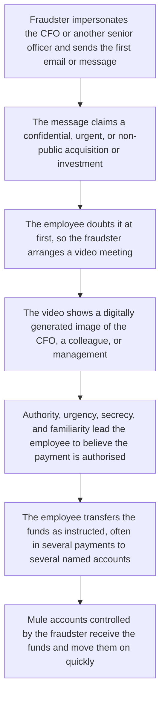
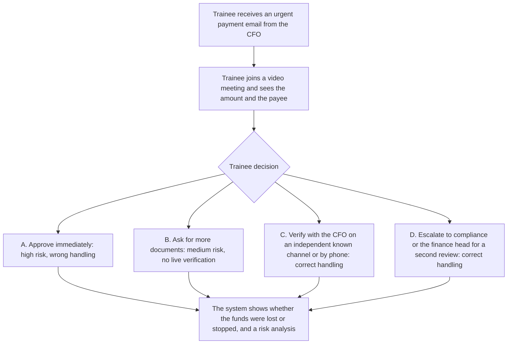

# 1. Deepfake executive impersonation

The playable script stays at [`data/cases/01-deepfake-hk-001.example.json`](../cases/01-deepfake-hk-001.example.json). Its `case_id` is `deepfake-001`. This page is for human review. It sets out the real-world flow and the platform teaching flow for that deepfake case.

## Real-world flow

Method and logic: fraudsters combine social engineering with digital synthesis. They persuade an employee who can authorise payments to complete a transfer that looks legitimate. They do not need to break into the bank or the IT system.

## Platform teaching flow

Trainee role: finance officer or payment approver.

Training goal: a video image is not proof that a payment was authorised. A high-risk payment must be checked on an independent channel that was set up in advance, such as a callback to a reserved phone number, or dual sign-off.

