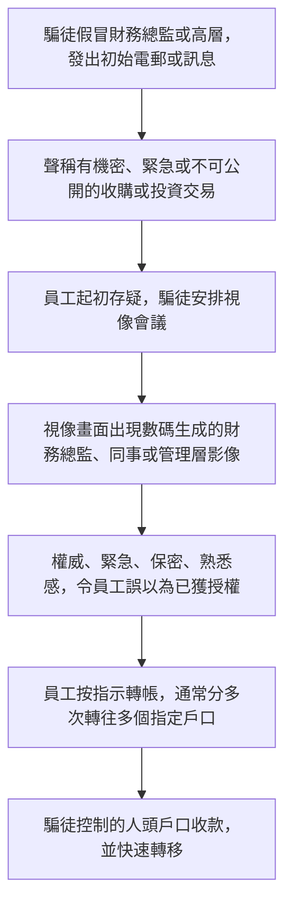
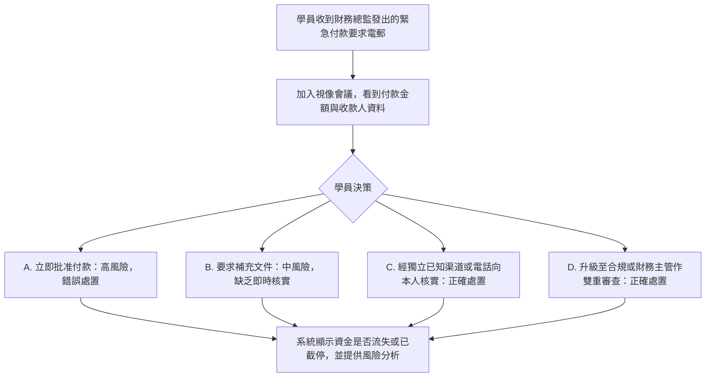

# 1. 深偽高層冒充案（Deepfake Executive Impersonation）

可玩劇本仍在 [`data/cases/01-deepfake-hk-001.example.json`](../cases/01-deepfake-hk-001.example.json)，`case_id` 為 `deepfake-hk-001`。本頁供人閱讀，說明這個深偽案例的現實運作流程與培訓平台教學流程。

## 現實運作流程

手法與邏輯：騙徒運用心理社交工程，搭配數碼合成技術，欺騙擁有付款權限的員工完成看起來合法的轉帳。騙徒無需入侵銀行或資訊科技系統。

## 培訓平台教學流程

學員角色：財務專員或付款審批人。

核心訓練目標：視像畫面不等於付款授權證明。高風險付款必須透過獨立、預先設定的渠道核實，例如回撥預留電話，或雙重簽署。

