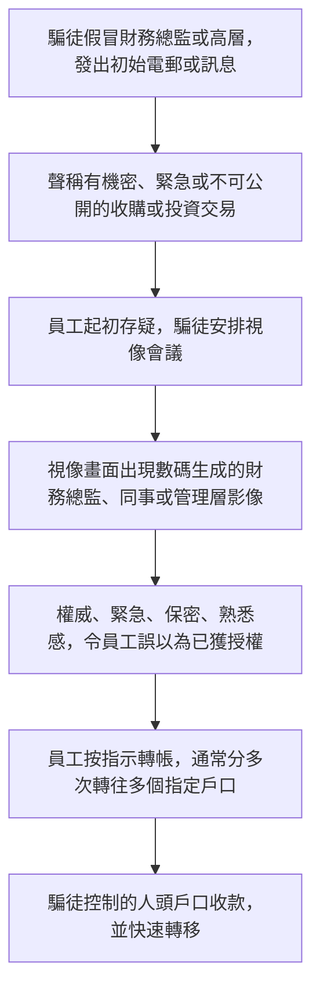
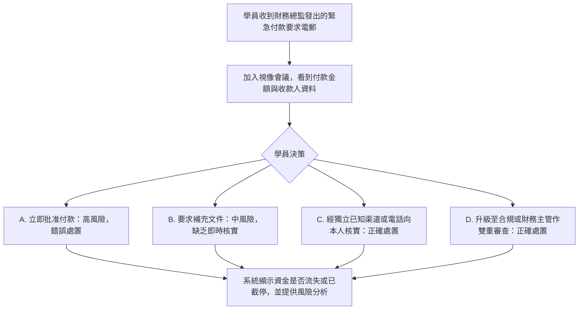

# 1. 深偽高層冒充案（Deepfake Executive Impersonation）

可玩劇本仍在 [`data/cases/01-deepfake-hk-001.example.json`](../cases/01-deepfake-hk-001.example.json)，`case_id` 為 `deepfake-hk-001`。本頁供人閱讀，說明這個深偽案例的現實運作流程與培訓平台教學流程。

## 現實運作流程

手法與邏輯：騙徒運用心理社交工程，搭配數碼合成技術，欺騙擁有付款權限的員工完成看起來合法的轉帳。騙徒無需入侵銀行或資訊科技系統。

## 培訓平台教學流程

學員角色：財務專員或付款審批人。

核心訓練目標：視像畫面不等於付款授權證明。高風險付款必須透過獨立、預先設定的渠道核實，例如回撥預留電話，或雙重簽署。

## 以下為近年受國際矚目的指標性重大案例：

1. 香港奧雅納（Arup）兩億港元詐騙案

- 案發時間：2024 年 1 月（警方於 2 月初對外公布）。
- 受害實體：英國知名工程顧問公司奧雅納（Arup） 的香港分公司。
- 手法細節：不法分子收集該公司高層的公開影音資料，利用 AI 製作出「多人在線」的虛假 Zoom 視訊會議。會議中除了受害財務員工一人是「真人」外，其餘的英國總部財務長及同僚全是由 Deepfake 生成的「數位假人」。員工誤以為是總部的機密收購任務，分 15 次將高達 2 億港元（約 2,560 萬美元） 匯入 5 個指定的香港銀行帳戶。
- 新聞連結: https://edition.cnn.com/2024/02/04/asia/deepfake-cfo-scam-hong-kong-intl-hnk

2. 新加坡首宗視訊深偽詐騙案

- 事發時間：受害財務董事於2025年3月24日接獲偽冒總公司CFO的訊息，並於3月25日登入Zoom「多人視像會議」。
- 詐騙手法：騙徒利用AI深偽技術，在視像會議中虛構多名公司高層與律師的形象與聲音，誘使該名財務董事誤信為真。
- 涉案金額：受害人按指示分次轉賬共約 49.9萬至50萬美元（折合約388萬至390萬港元）至指定的犯罪集團香港銀行戶口。
- 破案與追款：受害人事後起疑，成功阻止了一筆額外1.4萬美元的轉賬並通知匯豐銀行。新加坡反詐騙指揮處與香港警務處反詐騙協調中心迅速緊密合作，最終成功追回全數款項。
- 官方公告來源：詳細報導可參考 https://www.am730.com.hk/article/548706

3. 馬來西亞大眾銀行（Maybank）語音變臉案

- 案發時間：2024 年 4 月。
- 案件梗概：大眾銀行的分行財務主管落入類似的 AI 語音與視訊陷阱，歹徒冒充新加坡執行長及集團高層要求轉帳。該案差點損失 98.5 萬美元，事後涉及內部合規與權限審查。