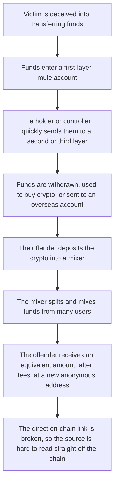
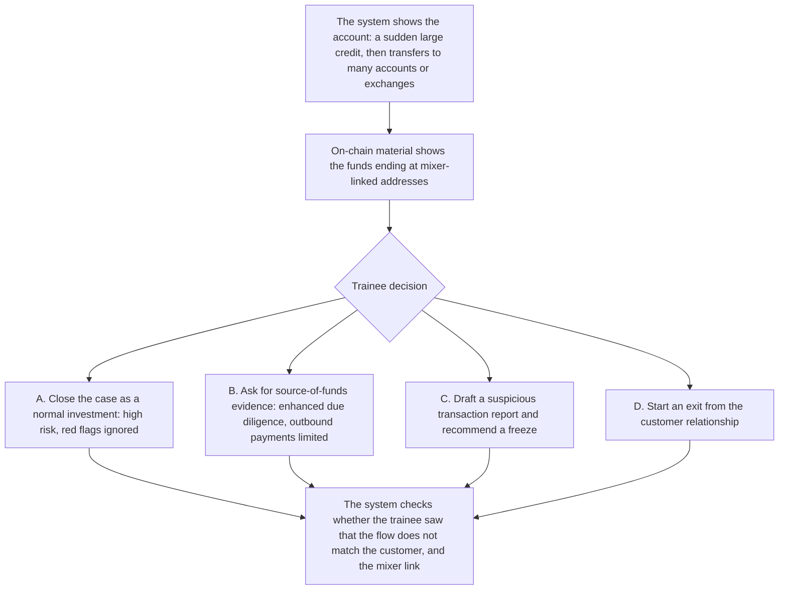

# 2. Crypto mixers and mule accounts

This page is for human review. Nearby playable scripts in `data/cases/` are `mule-rent-001`, `wiseword-amlmonth-001`, `greythunder-mule-001`, and `justicegate-crypto-001`. The decision node on this page is this teaching flow. It is not a line-by-line map of those scripts.

## Real-world flow

The method has two stages. Mule accounts move the victim's funds through layers. A crypto mixer then breaks the direct on-chain link. The aim is to make it harder to connect the original fraud proceeds to the offender.

## Platform teaching flow

Trainee role: bank AML analyst, or compliance officer at a crypto exchange.

Training goal: weigh several red flags together, then choose enhanced due diligence, a stop on the transaction, or a draft suspicious transaction report.

