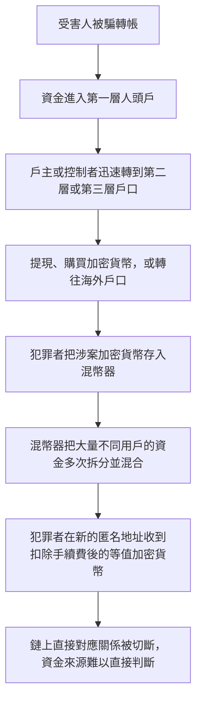
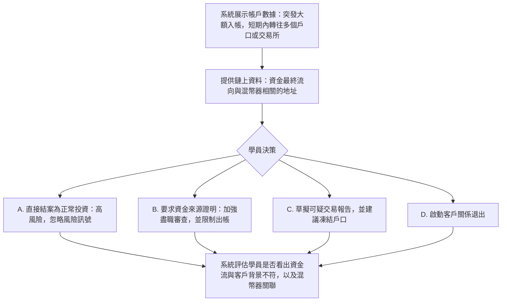

# 2. 人頭戶與加密貨幣混幣器（Crypto Mixers and Mule Accounts）

本頁供人閱讀。相近的可玩劇本在 `data/cases/`：`hk-mule-rent-001`、`hk-wiseword-amlmonth-001`、`hk-greythunder-mule-001`、`hk-justicegate-crypto-001`。本頁的決策節點是這條教學流程，不是那些劇本節點的逐字對照。

## 現實運作流程

手法與邏輯分兩段。人頭戶分流把受害人的款項逐層轉走。加密貨幣混幣把鏈上直接對應關係切斷。目的是讓調查人員更難把原始詐騙資金連到犯罪者。

## 培訓平台教學流程

學員角色：銀行反洗錢分析員，或加密貨幣交易所合規人員。

核心訓練目標：一併看多個風險訊號，再決定加強盡職審查、暫停交易，或草擬可疑交易報告。

