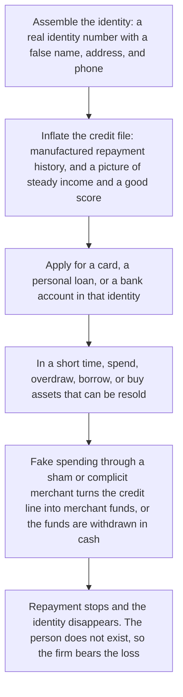
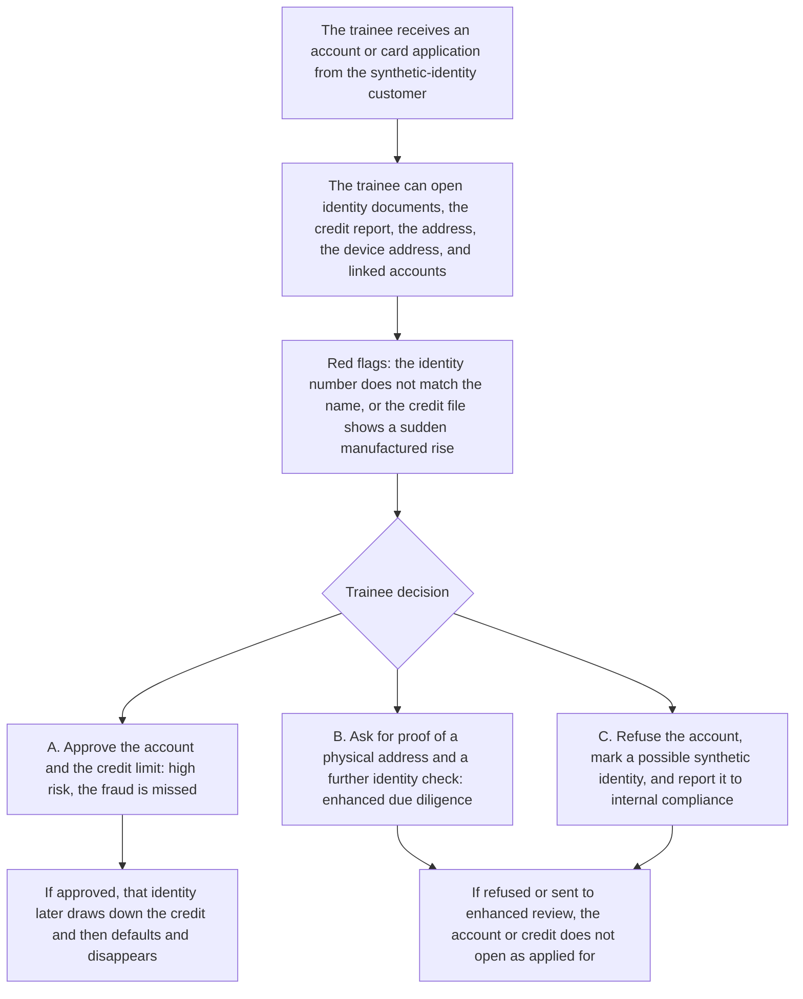

# 3. Synthetic identity fraud

This page is for human review. None of the eleven playable scripts is a synthetic-identity file. This page is the teaching flow for onboarding and credit.

## Real-world flow

Method and logic: a real identifier that has been stolen is combined with invented details to build a person who does not exist. The sequence is to assemble the identity, inflate the credit record, draw down the credit, and cash it out.

## Platform teaching flow

Trainee role: KYC reviewer, or an onboarding and credit reviewer.

Training goal: at onboarding and at a credit application, see contradictions in the file, an abnormal credit trail, and a complicit-merchant pattern.

## Training matrix for the first three cases

| Case | Trainee role | Decision question | What is marked |
| --- | --- | --- | --- |
| Deepfake executive impersonation | Finance officer or payment approver | Is this a real authorisation, or pressure from a fake senior officer? | Whether an independent channel was used, and whether dual authorisation was followed |
| Mule accounts and a crypto mixer | Bank AML analyst or exchange compliance officer | Does the flow match the customer, and is the mixer activity explained? | How many red flags were seen, and whether the trainee chose enhanced due diligence, a limit, or a suspicious transaction report |
| Synthetic identity fraud | KYC, onboarding, or credit reviewer | Is this a real customer, or an identity assembled from pieces? | Contradictions found, an abnormal credit trail, and a merchant cash-out pattern |
