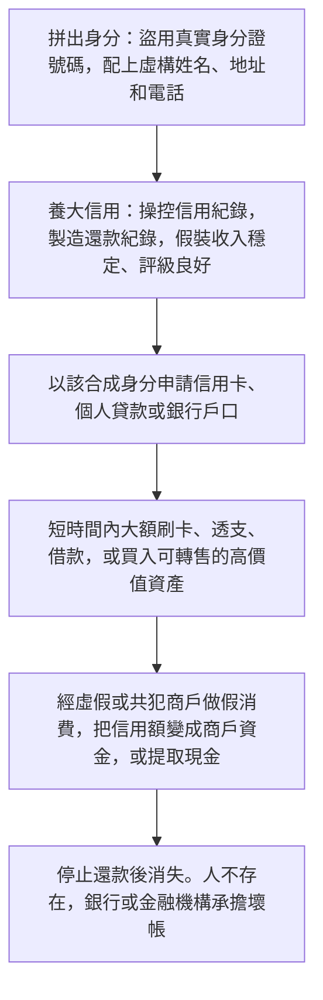
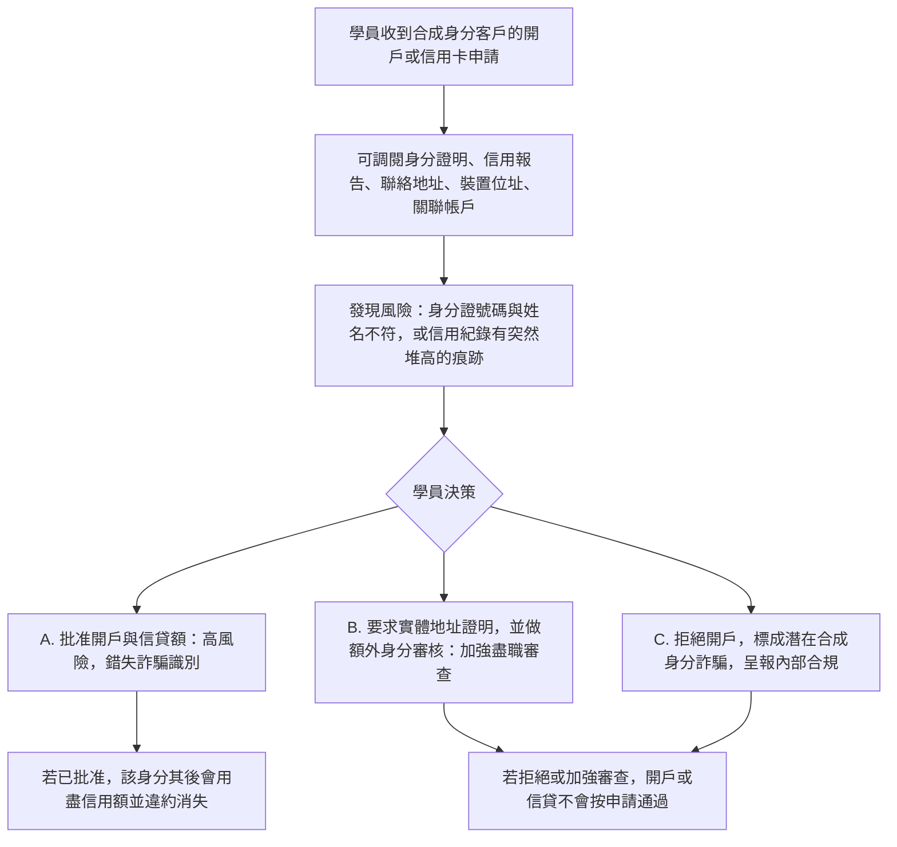

# 3. 合成身分詐騙（Synthetic Identity Fraud）

本頁供人閱讀。現有十一個可玩劇本沒有合成身分檔。本頁是開戶與信貸階段的教學流程。

## 現實運作流程

手法與邏輯：把真實但被盜用的個人資料，與虛構資料拼成一個不存在的新身分。過程是拼出身分、養大信用、用盡信貸並變現。

## 培訓平台教學流程

學員角色：認識客戶審批員，或開戶與信貸審查人員。

核心訓練目標：在開戶及申請信貸時，看出資料矛盾、異常信用軌跡，以及共犯商戶模式。

## 前三類個案的培訓對照

| 案例 | 學員角色 | 核心決策問題 | 關鍵考核 |
| --- | --- | --- | --- |
| 深偽高層冒充 | 財務專員或付款審批人 | 這是真實授權，還是假冒高層造成的心理壓力？ | 有否用獨立渠道核實，有否遵守雙重授權 |
| 人頭戶與加密貨幣混幣器 | 銀行反洗錢分析員或交易所合規人員 | 資金流向是否與客戶背景一致？混幣器交易能否合理解釋？ | 識別了多少風險訊號，有否加強盡職審查、限制交易或呈報可疑交易 |
| 合成身分詐騙 | 認識客戶、開戶與信貸審查人員 | 這是真實客戶，還是拼湊出來的假身分？ | 有否發現資料矛盾、異常信用軌跡、商戶套現模式 |
