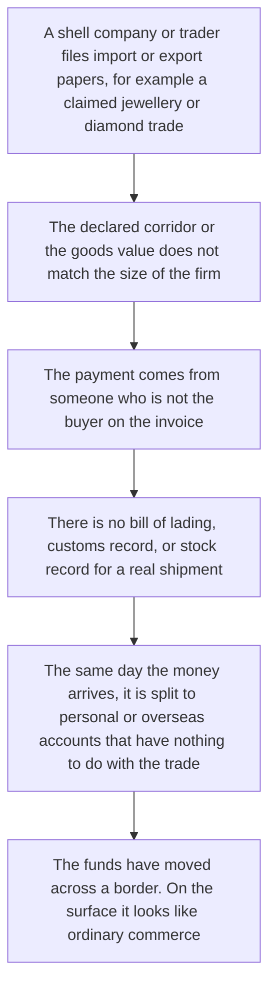
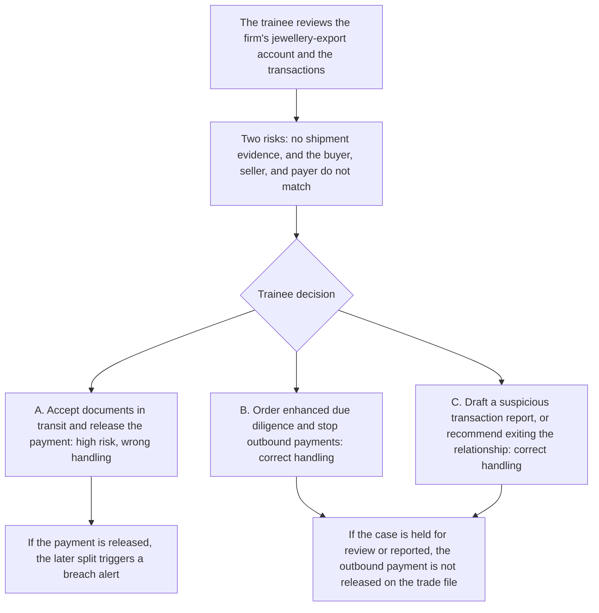

# 4. Trade-based money laundering

This page is for human review. The playable script is [`data/cases/02-daybreak-tbml-001.example.json`](../cases/02-daybreak-tbml-001.example.json). Its `case_id` is `hk-daybreak-tbml-001`. The public-reporting note is in [`data/cases/README.md`](../cases/README.md).

## Real-world flow

Method and logic: a criminal group uses international trade as cover. Goods are overpriced or invented, and the invoice does not match the shipping papers. Illegal funds cross a border as if they were trade payments.

In public reporting, this method uses shell companies to create a large false trade flow and to get around exchange controls and compliance review. Hong Kong Customs reporting on jewellery-trade laundering is the inspiration for `hk-daybreak-tbml-001`. It is not the customer file inside the script.

## Platform teaching flow

Trainee role: trade-finance officer, or a corporate compliance reviewer.

Training goal: see the gaps in the papers, including missing shipment evidence and a third-party payer. Do not treat those gaps as documents still in transit, or as an ordinary commercial delay.

After a release, the check is whether the trainee followed the rules in the script. A later oral explanation is not that check.
