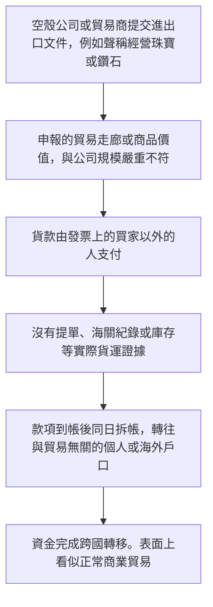
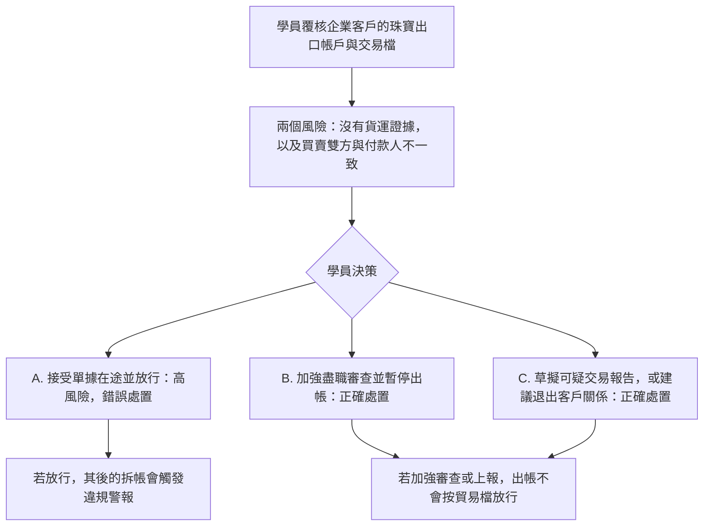

# 4. 貿易洗錢（Trade-Based Money Laundering）

本頁供人閱讀。可玩劇本是 [`data/cases/02-daybreak-tbml-001.example.json`](../cases/02-daybreak-tbml-001.example.json)，`case_id` 為 `daybreak-tbml-001`。公開報道的靈感說明在 [`data/cases/README.md`](../cases/README.md)。

## 現實運作流程

手法與邏輯：犯罪集團以國際貿易作掩護。貨物價值被虛高或虛構，發票與貨運文件對不上。非法資金以貿易貨款的名義跨境轉移。

公開報道裡，這類手法會用空殼公司做出大額虛假貿易流，用來避開外匯管制與合規審查。香港海關曾公布的珠寶貿易洗錢報道，是 `daybreak-tbml-001` 的靈感來源，不是這份劇本裡的客戶檔。

## 培訓平台教學流程

學員角色：銀行貿易融資人員，或企業合規審查員。

核心訓練目標：看出文件缺口，包括沒有貨運證據、以及第三者付款。不要把缺口當成單據在途或一般商業時差。

放行之後，檢視的是學員有否按劇本裡的規則處理，而不是事後口述。
