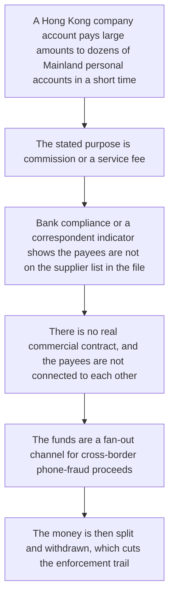
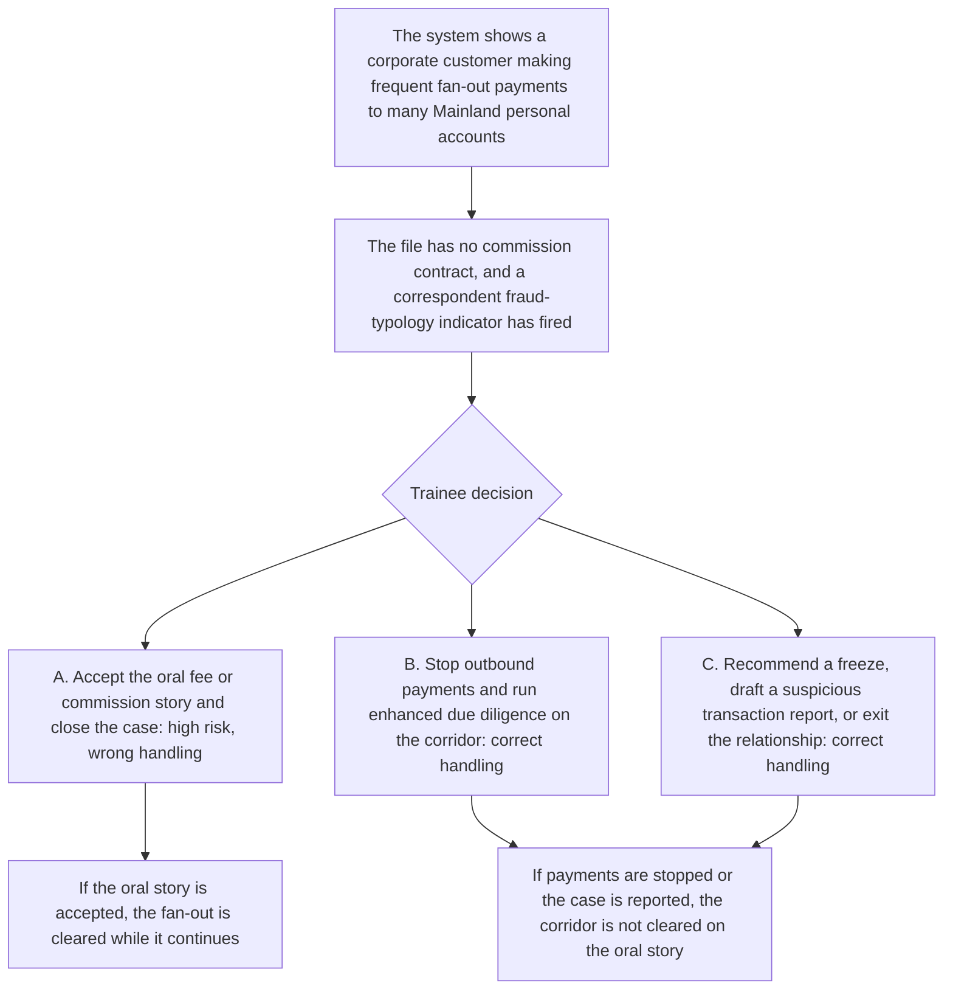

# 5. Cross-border phone-fraud corridors

This page is for human review. The playable script is [`data/cases/07-crossborder-tel-001.example.json`](../cases/07-crossborder-tel-001.example.json). Its `case_id` is `hk-crossborder-tel-001`. The public-reporting note is in [`data/cases/README.md`](../cases/README.md).

## Real-world flow

Method and logic: a criminal group uses a cross-border remittance corridor, such as a Hong Kong company paying Mainland personal accounts. Nominal commission or a fee paid for a customer is the cover. Phone-fraud proceeds are fanned out quickly to many unrelated personal accounts.

The public-reporting note for `hk-crossborder-tel-001` is the inspiration. It is not the customer file inside the script.

## Platform teaching flow

Trainee role: cross-border compliance officer, or a transaction-monitoring analyst.

Training goal: recognise a large set of personal payees with no contract, and a phone-fraud corridor indicator. Do not close the case on an oral story that the firm was paying a fee for a customer, or paying commission.

The check is whether the trainee holds the line when the indicators are already on the file, and refuses a passive close.
