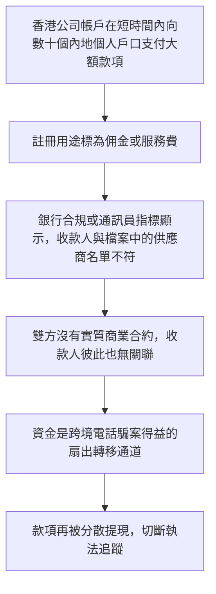
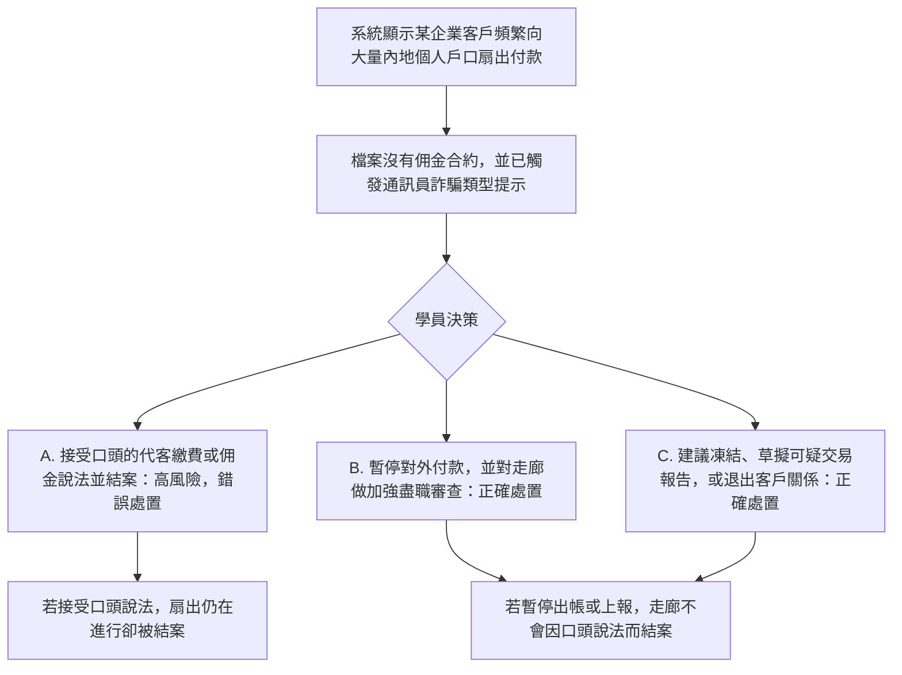

# 5. 跨境電話騙案走廊與集團式轉帳

本頁供人閱讀。可玩劇本是 [`data/cases/07-crossborder-tel-001.example.json`](../cases/07-crossborder-tel-001.example.json)，`case_id` 為 `crossborder-tel-001`。公開報道的靈感說明在 [`data/cases/README.md`](../cases/README.md)。

## 現實運作流程

手法與邏輯：犯罪集團針對跨境匯款走廊，例如香港公司付往內地個人戶口。名義上的佣金或代客繳費是掩護。電話騙案所得很快扇出到大量互不相關的個人帳戶。

`crossborder-tel-001` 的公開報道說明是靈感來源，不是這份劇本裡的客戶檔。

## 培訓平台教學流程

學員角色：跨境合規主任，或交易監測分析員。

核心訓練目標：辨識沒有合約的大量個人收款，以及電話騙案走廊指標。不要輕信客戶口頭改口的代繳或佣金藉口。

檢視的是學員在風險指標已經出現時，有否緊守規則，拒絕被動結案。
