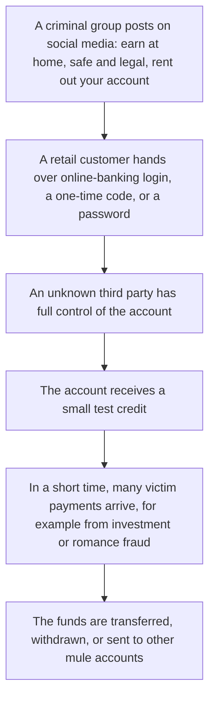
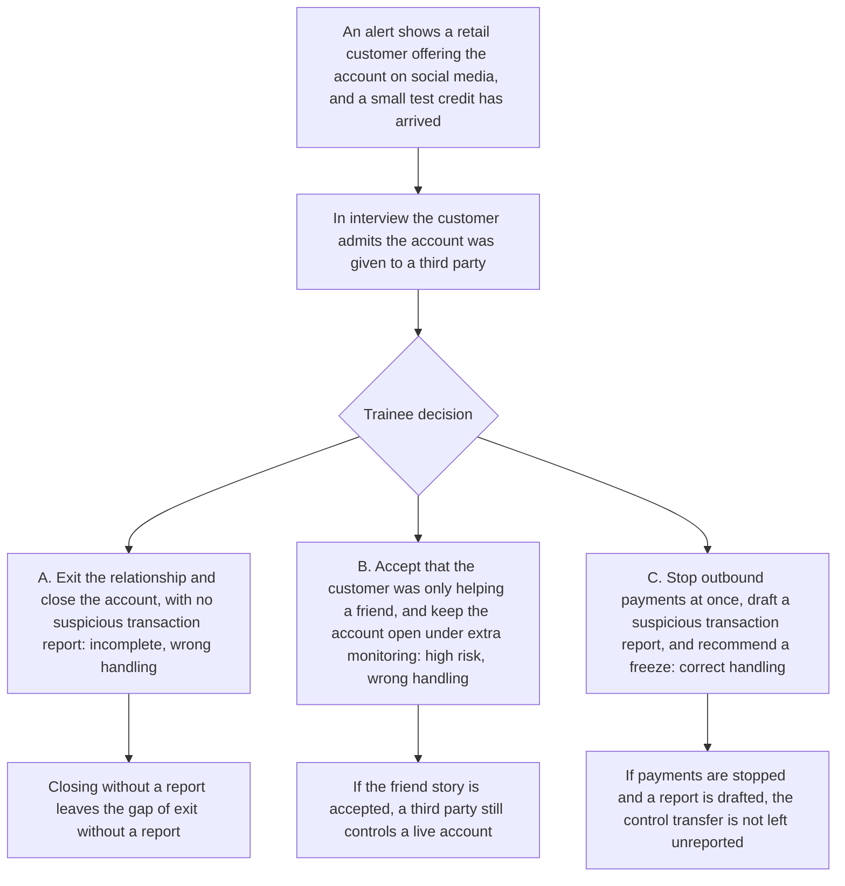

# 6. Account rental and mule clusters

This page is for human review. Nearby playable scripts are [`data/cases/03-mule-rent-001.example.json`](../cases/03-mule-rent-001.example.json) (`mule-rent-001`) and [`data/cases/06-greythunder-mule-001.example.json`](../cases/06-greythunder-mule-001.example.json) (`greythunder-mule-001`). The decision node on this page is this teaching flow. It is not a line-by-line map of those scripts.

## Real-world flow

Method and logic: a criminal group recruits people who need money, such as students or people on a low income, on social media. The offer is to rent or sell control of a bank account. After control passes, a small test credit arrives, and the account then becomes a hub for fraud proceeds.

The public-reporting notes for `mule-rent-001` and `greythunder-mule-001` are the inspiration. They are not the customer files inside the scripts.

## Platform teaching flow

Trainee role: retail-bank risk officer, or a mule-monitoring specialist.

Training goal: when account rental or third-party control is on the file, report it and stop payments. Closing the account without a suspicious transaction report is an incomplete exit.

The check is whether the trainee avoids the common gap of walking away from the customer and omitting the report.

## Training matrix for cases 4 to 6

| Case | Trainee role | Decision question | What is marked |
| --- | --- | --- | --- |
| 4. Trade-based money laundering | Trade-finance reviewer | Is this jewellery trade real commerce, or financing cover for a shell company? | Whether the paper gaps were seen, including a missing bill of lading or a buyer mismatch, and whether enhanced due diligence was required |
| 5. Cross-border phone-fraud corridor | Cross-border compliance officer | Are these many personal payments lawful commission, or a corridor for phone-fraud proceeds? | Whether the oral excuse was refused, and whether the corridor was paused and a suspicious transaction report was drafted |
| 6. Account rental and mule clusters | Retail risk officer | After the customer hands the account to a third party, can the firm only close the account and not report? | Whether the transfer of control was seen, and whether exit without a report was avoided |
