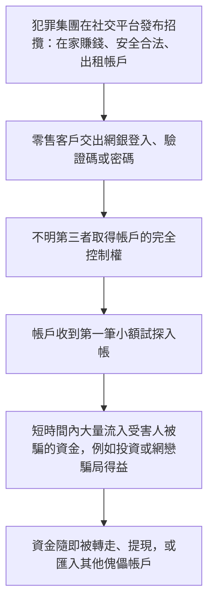
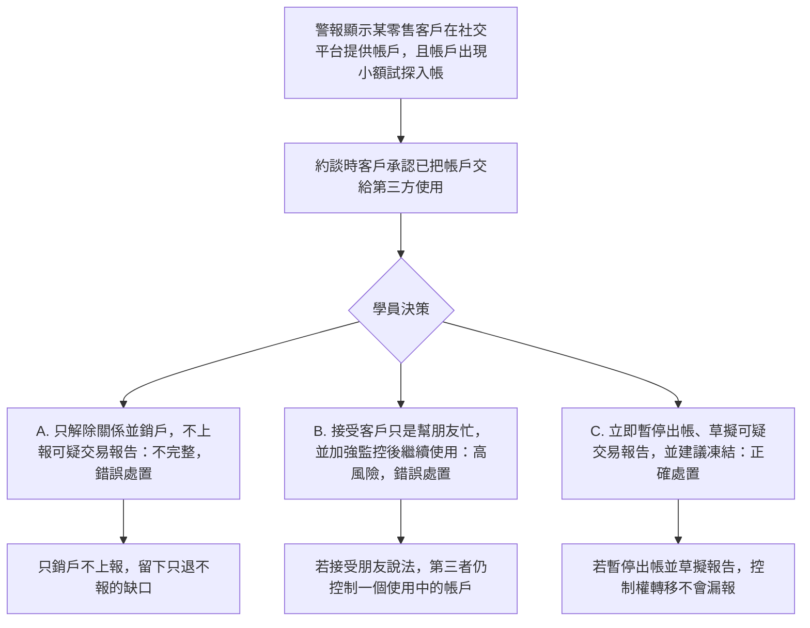

# 6. 帳戶租售與錢騾群組

本頁供人閱讀。相近的可玩劇本是 [`data/cases/03-mule-rent-001.example.json`](../cases/03-mule-rent-001.example.json)（`hk-mule-rent-001`）與 [`data/cases/06-greythunder-mule-001.example.json`](../cases/06-greythunder-mule-001.example.json)（`hk-greythunder-mule-001`）。本頁的決策節點是這條教學流程，不是那些劇本節點的逐字對照。

## 現實運作流程

手法與邏輯：犯罪集團在社交平台招攬急需資金的人，例如學生或低收入者，以金錢租借或買下銀行帳戶的控制權。取得控制權後，先以小額試探，再把帳戶用作收取詐騙得益的樞紐。

`hk-mule-rent-001` 與 `hk-greythunder-mule-001` 的公開報道說明是靈感來源，不是那些劇本裡的客戶檔。

## 培訓平台教學流程

學員角色：零售銀行風險控制，或錢騾監測專員。

核心訓練目標：發現帳戶租賃招攬或第三者控制時，必須上報並止付。只關閉帳戶而不呈報可疑交易報告，是不完整的流程。

檢視的是學員有否避開常見漏洞：只退出關係，卻漏報可疑交易。

## 個案 4 至 6 的培訓對照

| 案例 | 學員角色 | 核心決策問題 | 關鍵考核 |
| --- | --- | --- | --- |
| 4. 貿易洗錢 | 貿易融資審查員 | 這筆珠寶貿易是真實商業活動，還是空殼公司的融資掩護？ | 有否識別文件缺口，包括提單或買家不符，有否強制執行加強盡職審查 |
| 5. 跨境電話騙案走廊 | 跨境合規主任 | 這大量個人匯款是合法佣金，還是電話騙案的贓款走廊？ | 有否拒絕口頭藉口，有否落實走廊暫停與可疑交易呈報 |
| 6. 帳戶租售與錢騾群組 | 零售風險控制專員 | 客戶把帳戶交給第三者後，能否只銷戶而不上報？ | 有否識別控制權轉移，有否避免只退不報的不完整合規 |
