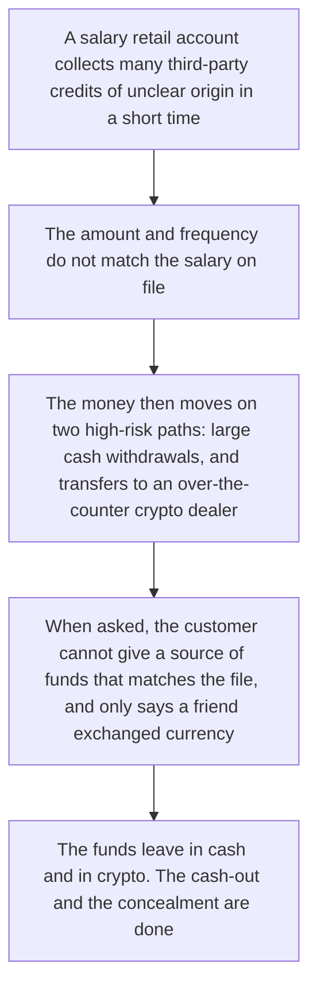
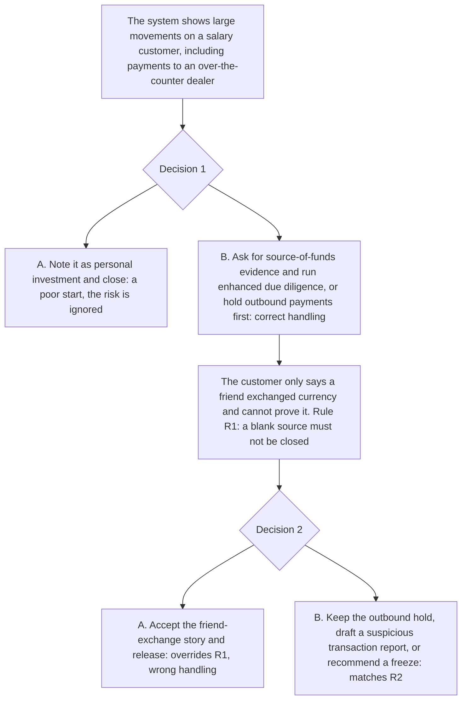

# 7. Cash and crypto OTC cashing-out

This page is for human review. The playable script is [`data/cases/05-justicegate-crypto-001.example.json`](../cases/05-justicegate-crypto-001.example.json). Its `case_id` is `justicegate-crypto-001`. The public-reporting note is in [`data/cases/README.md`](../cases/README.md).

## Real-world flow

Method and logic: a salary retail account collects many third-party credits, then the funds leave through large cash withdrawals and transfers to an over-the-counter crypto dealer. The aim is to cash out and move the money out of ordinary bank monitoring.

The public-reporting note for `justicegate-crypto-001` is the inspiration. It is not the customer file inside the script.

## Platform teaching flow

Trainee role: retail-bank AML alert reviewer.

Training goal: when the customer cannot show a source of funds that matches the file, do not accept that gap as an explanation. Cash plus an over-the-counter crypto dealer calls for a hold, a freeze recommendation, or a report.

The check is whether the trainee refuses a blank source, and whether cash plus an over-the-counter path is held or reported.
