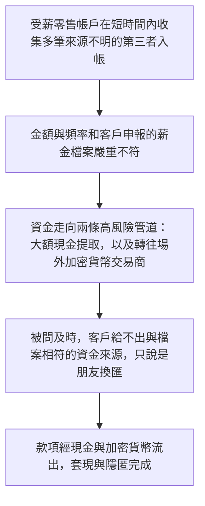
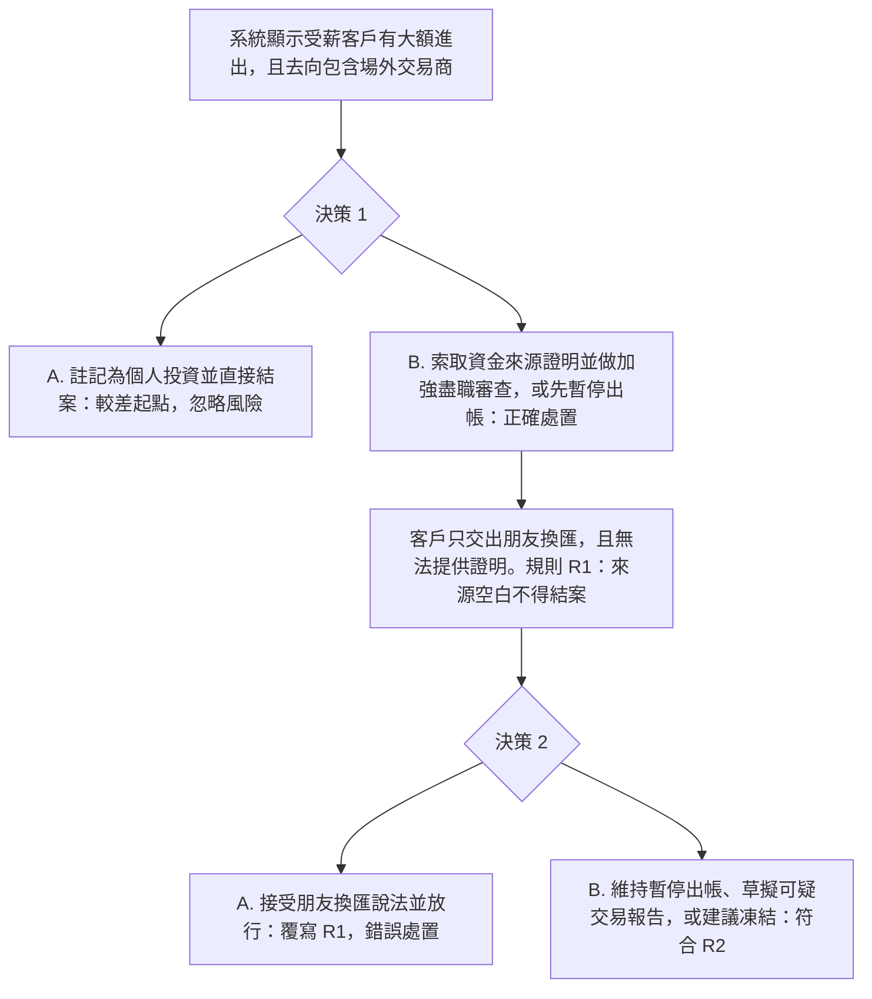

# 7. 現金與場外加密貨幣套現

本頁供人閱讀。可玩劇本是 [`data/cases/05-justicegate-crypto-001.example.json`](../cases/05-justicegate-crypto-001.example.json)，`case_id` 為 `hk-justicegate-crypto-001`。公開報道的靈感說明在 [`data/cases/README.md`](../cases/README.md)。

## 現實運作流程

手法與邏輯：受薪零售帳戶收集多筆第三者入帳，再以大額現金提取，以及轉往場外加密貨幣交易商，把資金套現並移走，避開銀行的持續監控。

`hk-justicegate-crypto-001` 的公開報道說明是靈感來源，不是這份劇本裡的客戶檔。

## 培訓平台教學流程

學員角色：零售銀行反洗錢警報審查員。

核心訓練目標：客戶交不出與檔案相符的資金來源時，不得把它當成合理解釋。面對現金加上場外加密貨幣的去向，必須止付、建議凍結或上報。

檢視的是學員有否拒絕空白來源，以及有否對現金加場外交易商的路徑止付或上報。
