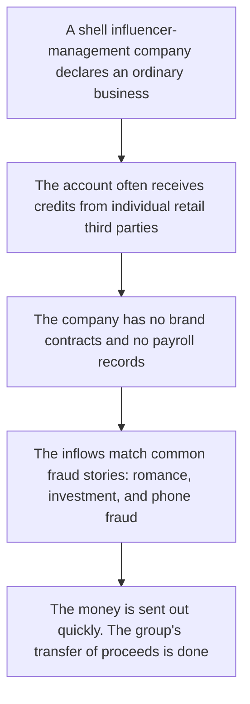
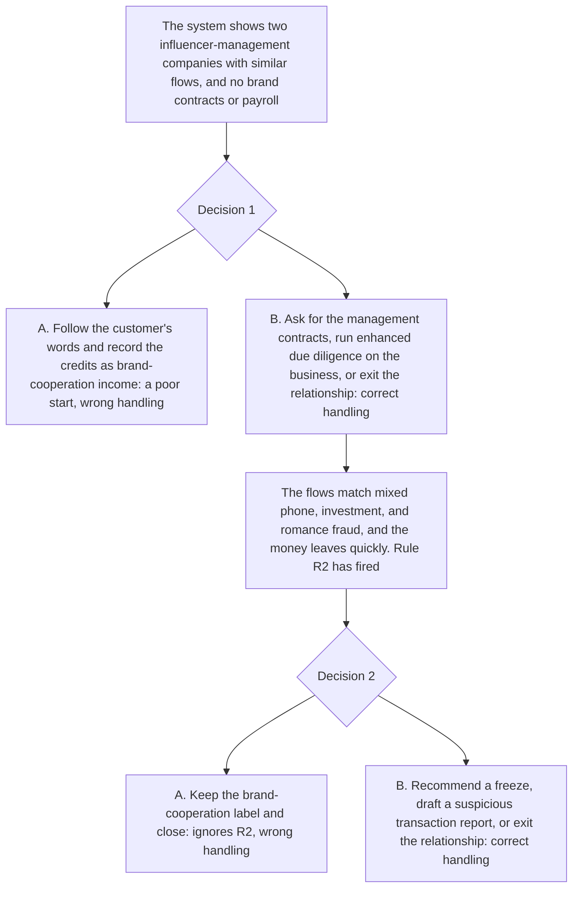

# 8. KOL management front company

This page is for human review. The playable script is [`data/cases/08-kol-mgmt-001.example.json`](../cases/08-kol-mgmt-001.example.json). Its `case_id` is `kol-mgmt-001`. The public-reporting note is in [`data/cases/README.md`](../cases/README.md).

## Real-world flow

Method and logic: a criminal group sets up or controls a company that looks like influencer management, public relations, or entertainment. There are no brand contracts, no real business, and no payroll. The account takes in retail third-party funds, often tied to phone, investment, or romance fraud stories, and sends them out quickly.

The public-reporting note for `kol-mgmt-001` is the inspiration. It is not the customer file inside the script.

## Platform teaching flow

Trainee role: corporate compliance officer, or a company-account reviewer.

Training goal: a front company with no contracts and no payroll must not have its retail credits, or a fraud story, relabelled as brand-cooperation income. Run enhanced due diligence, hold outbound payments, or draft a suspicious transaction report.

The check is whether the trainee runs due diligence on the front business, and refuses to dress a mixed fraud story up as commercial income.
