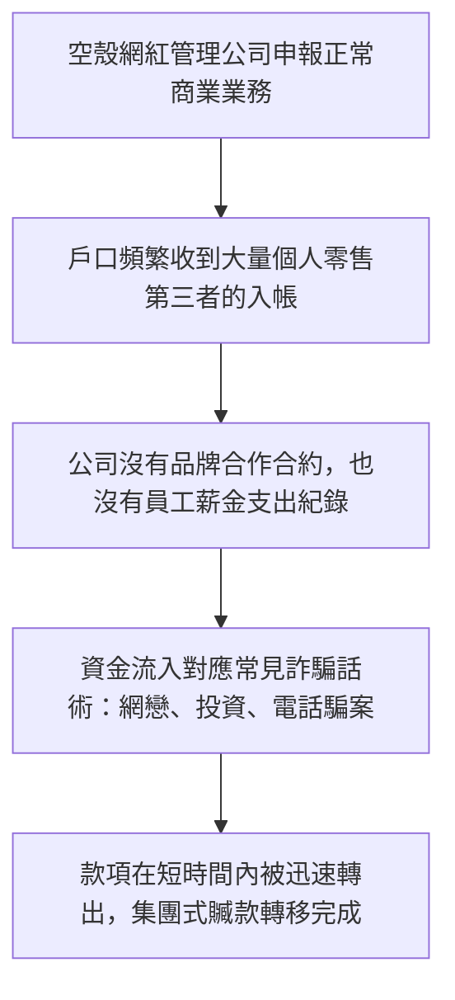
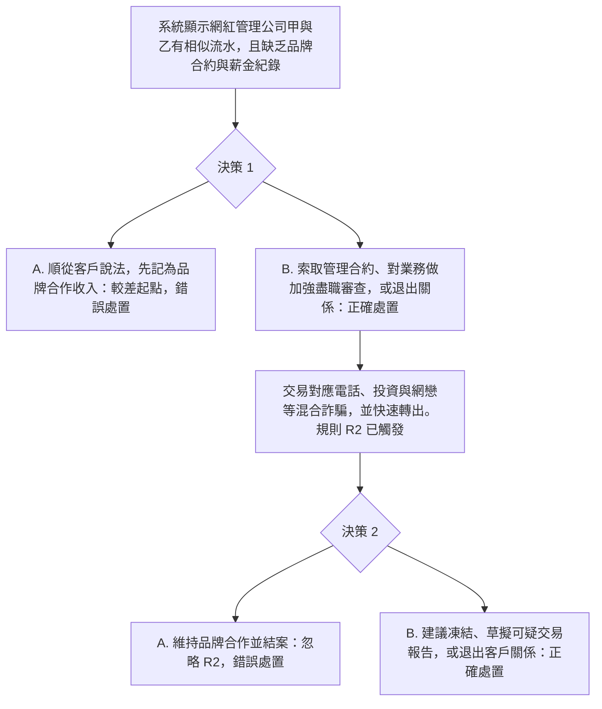

# 8. 網紅管理公司前台戶口

本頁供人閱讀。可玩劇本是 [`data/cases/08-kol-mgmt-001.example.json`](../cases/08-kol-mgmt-001.example.json)，`case_id` 為 `kol-mgmt-001`。公開報道的靈感說明在 [`data/cases/README.md`](../cases/README.md)。

## 現實運作流程

手法與邏輯：犯罪集團成立或操控看似經營網紅管理、公關或娛樂的公司。沒有品牌合約、沒有實際商業活動，也沒有員工薪金紀錄。帳戶專門收取零售第三者的資金，話術常是電話騙案、投資騙局或網戀騙局，並在短時間內轉出。

`kol-mgmt-001` 的公開報道說明是靈感來源，不是這份劇本裡的客戶檔。

## 培訓平台教學流程

學員角色：企業合規主任，或公司戶口覆核員。

核心訓練目標：面對沒有合約、沒有員工紀錄的企業前台，不得把零售入帳或詐騙話術改記為品牌合作收入。必須加強審查、暫停出帳或呈報可疑交易。

檢視的是學員有否對前台業務做盡職審查，以及有否拒絕把混合詐騙話術記成商業收入。
