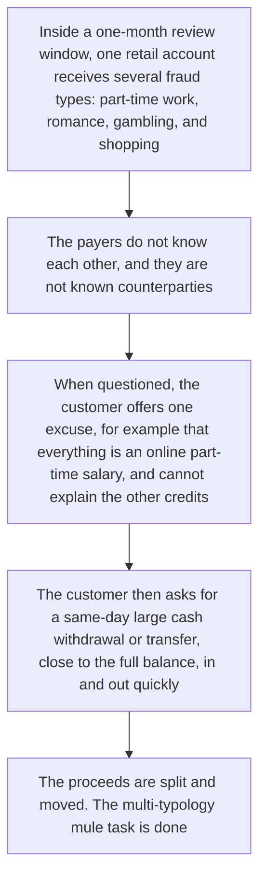
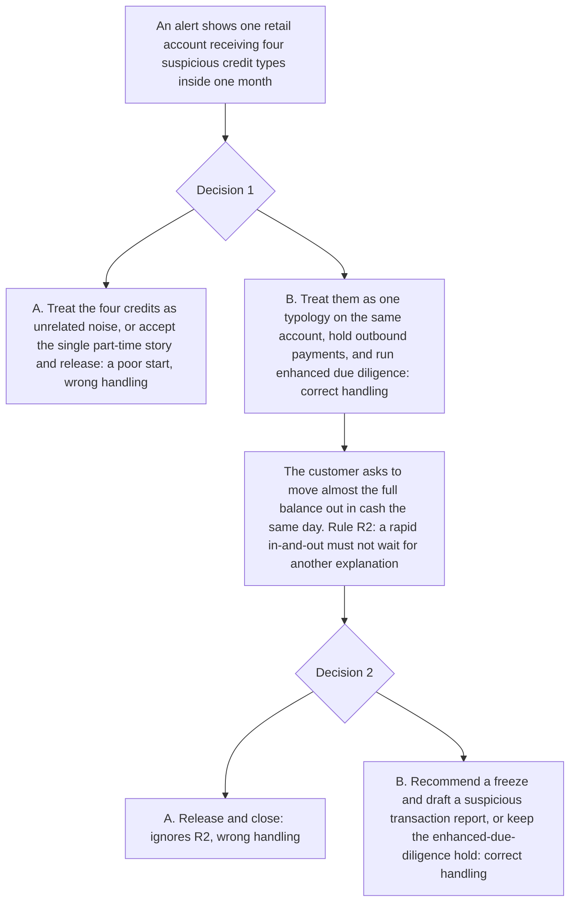

# 9. Multi-typology mule account

This page is for human review. The playable script is [`data/cases/04-wiseword-amlmonth-001.example.json`](../cases/04-wiseword-amlmonth-001.example.json). Its `case_id` is `hk-wiseword-amlmonth-001`. The public-reporting note is in [`data/cases/README.md`](../cases/README.md).

## Real-world flow

Method and logic: one retail mule account, inside a short window such as one month, receives proceeds from several fraud types: a part-time-job salary, a romance gift, a gambling top-up refund, a shopping refund. The payers do not know each other. When questioned, the customer offers one story, such as an online part-time job, while asking for a same-day near-full cash-out.

The public-reporting note for `hk-wiseword-amlmonth-001` is the inspiration. It is not the customer file inside the script.

## Platform teaching flow

Trainee role: senior transaction-monitoring analyst, or a retail risk officer.

Training goal: when one account shows several fraud types, do not close on the customer's single story. A request to move almost the full balance the same day calls for a hold, a freeze recommendation, or a report.

The check is whether the trainee sees the types together, and whether a rapid in-and-out is frozen or reported.

## Training matrix for cases 7 to 9

| Case | Trainee role | Decision question | What is marked |
| --- | --- | --- | --- |
| 7. Cash and crypto OTC cashing-out | Retail-bank AML reviewer | The customer cannot show a reasonable source of funds, and the money goes to cash and an over-the-counter dealer. Can this be closed as an ordinary investment? | Whether a blank source was refused, and whether the cash plus over-the-counter path was held or reported |
| 8. KOL management front company | Corporate compliance officer | A company account with no contracts receives retail credits. Can an oral explanation turn that into brand-cooperation income? | Whether enhanced due diligence was run on the front business, and whether a mixed fraud story was refused as commercial income |
| 9. Multi-typology mule, one-month alert | Senior transaction-monitoring analyst | The account receives several fraud types at once. Can the customer's single part-time story be enough to release? | Whether the types were seen together, and whether a rapid in-and-out was frozen and reported |
