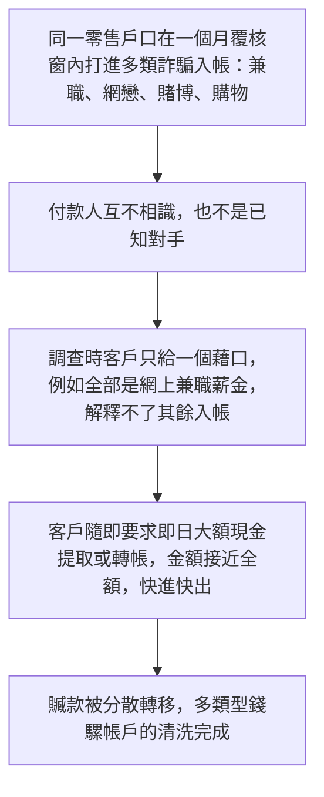
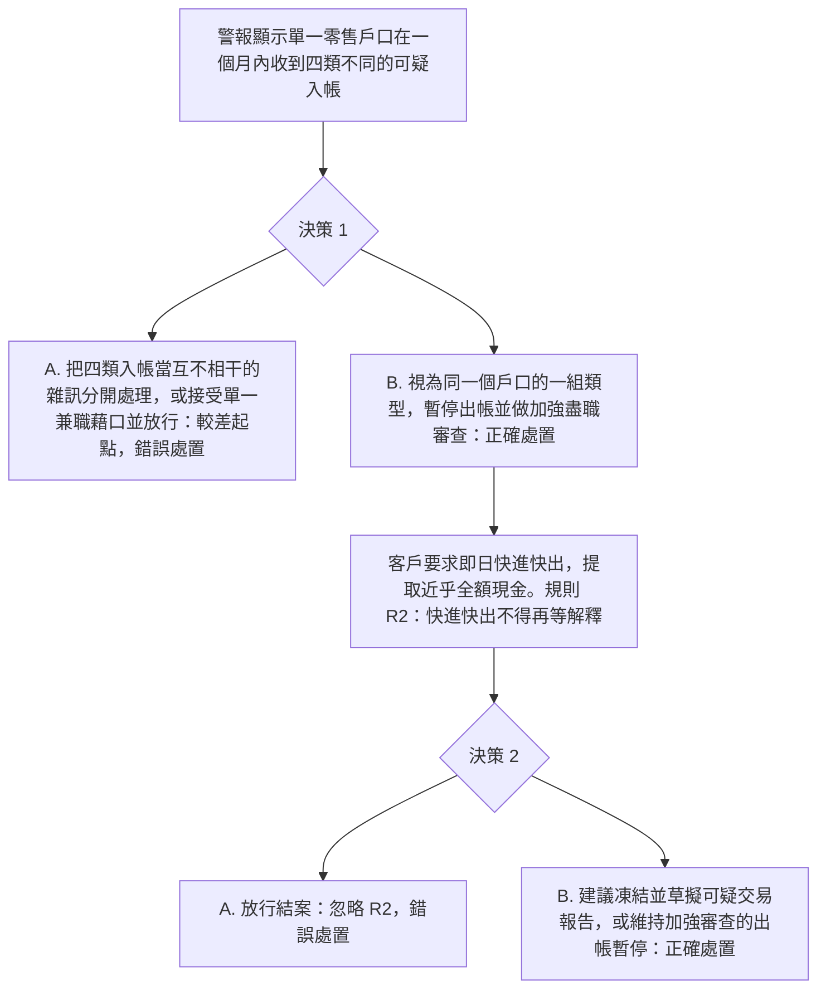

# 9. 多類型騾子戶口，一個月警報

本頁供人閱讀。可玩劇本是 [`data/cases/04-wiseword-amlmonth-001.example.json`](../cases/04-wiseword-amlmonth-001.example.json)，`case_id` 為 `wiseword-amlmonth-001`。公開報道的靈感說明在 [`data/cases/README.md`](../cases/README.md)。

## 現實運作流程

手法與邏輯：同一個零售人頭帳戶在短時間內，例如一個月，頻繁收到多種詐騙贓款，如兼職騙局薪金、網戀贈與、賭博充值退回、購物退款。付款人互不相干。被查問時，客戶只用一個藉口，例如網上兼職，同時要求即日把接近全額快進快出。

`wiseword-amlmonth-001` 的公開報道說明是靈感來源，不是這份劇本裡的客戶檔。

## 培訓平台教學流程

學員角色：交易監測高級分析員，或零售風險管理人員。

核心訓練目標：同一帳戶出現多類詐騙入帳時，不得接受客戶的單一故事結案。面對快進快出的提款要求，必須暫停、建議凍結或呈報。

檢視的是學員有否把多種類型放在一起看，以及快進快出時有否凍結並上報。

## 個案 7 至 9 的培訓對照

| 案例 | 學員角色 | 核心決策問題 | 關鍵考核 |
| --- | --- | --- | --- |
| 7. 現金與場外加密貨幣套現 | 零售銀行反洗錢審查員 | 客戶交不出合理資金來源，且資金走向現金與場外找換，能否當作普通投資結案？ | 有否拒絕空白來源，有否對現金加場外路徑止付或呈報 |
| 8. 網紅管理公司前台戶口 | 企業合規主任 | 沒有合約的企業戶口收到零售入帳，能否因口頭解釋記成品牌合作？ | 有否對前台業務做加強盡職審查，有否拒絕把混合詐騙話術當成商業收入 |
| 9. 多類型騾子戶口月度警報 | 交易監測高級分析員 | 帳戶同時收到多類詐騙入帳，能否只聽單一兼職藉口就放行？ | 有否識別多類型共存，快進快出時有否落實凍結與上報 |
