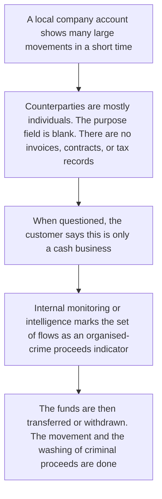
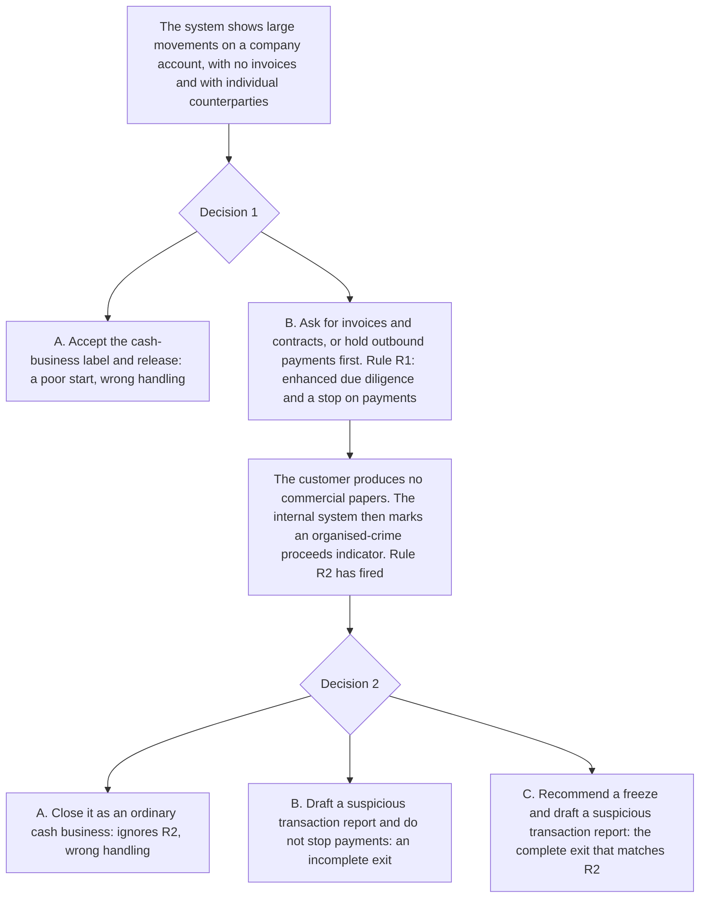

# 10. Organised-crime cashflow

This page is for human review. The playable script is [`data/cases/09-triad-cashflow-001.example.json`](../cases/09-triad-cashflow-001.example.json). Its `case_id` is `triad-cashflow-001`. The public-reporting note is in [`data/cases/README.md`](../cases/README.md).

## Real-world flow

Method and logic: an organised-crime network moves large amounts, at high frequency, through local company accounts. The accounts have no invoices, no commercial contracts, and no payroll. Counterparties are often individuals. When the bank asks, the story is a cash business or wholesale trade.

The public-reporting note for `triad-cashflow-001` is the inspiration. It is not the customer file inside the script.

## Platform teaching flow

Trainee role: senior compliance officer, or an AML investigator.

Training goal: an oral label of cash business is not evidence. When the internal typology marks organised-crime proceeds, drafting a report alone is incomplete. Outbound payments must be held, and a freeze must be recommended.

On this script, drafting a report without a freeze recommendation does not clear `R2_OC_INDICATOR`. That incomplete exit is listed in [`data/cases/README.md`](../cases/README.md).
