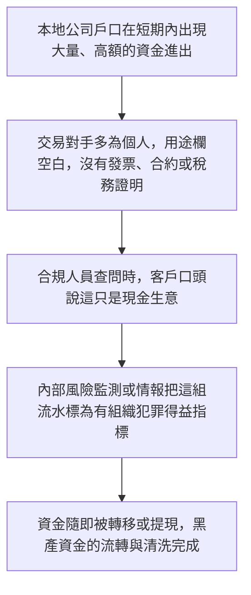
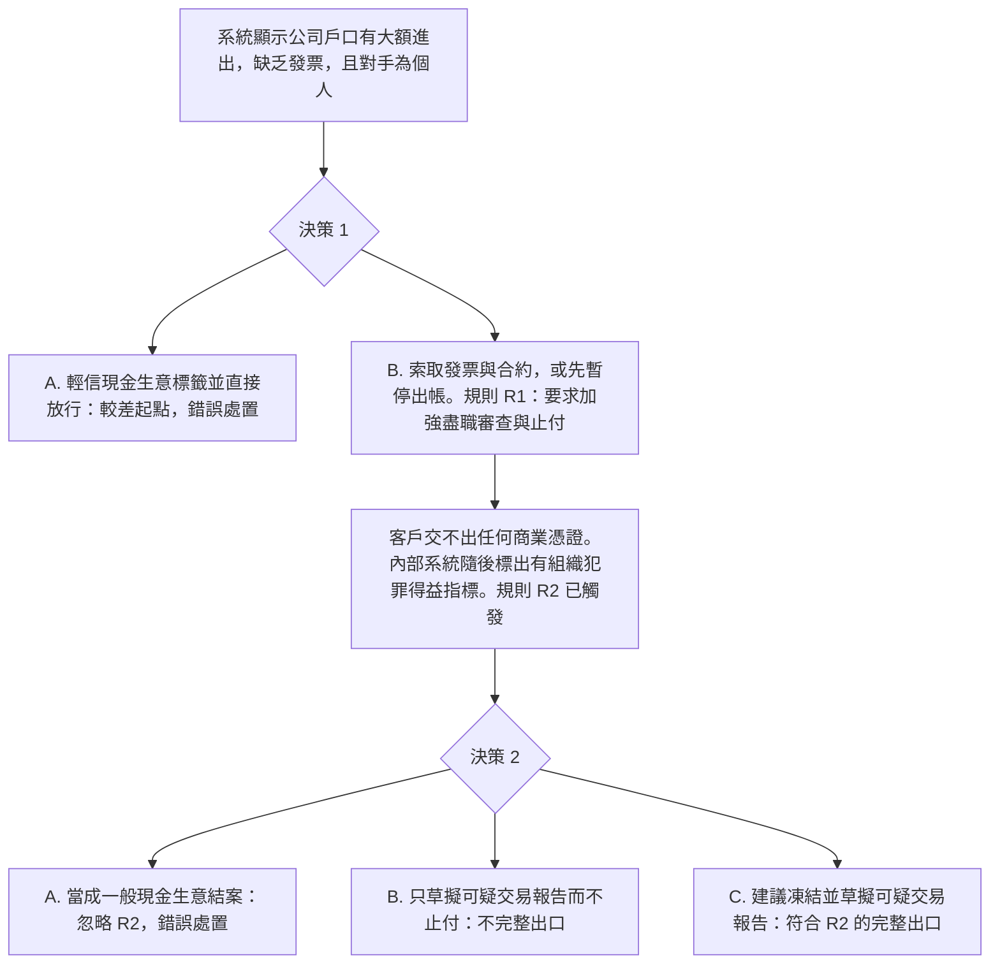

# 10. 無商業目的流水，有組織犯罪指標

本頁供人閱讀。可玩劇本是 [`data/cases/09-triad-cashflow-001.example.json`](../cases/09-triad-cashflow-001.example.json)，`case_id` 為 `hk-triad-cashflow-001`。公開報道的靈感說明在 [`data/cases/README.md`](../cases/README.md)。

## 現實運作流程

手法與邏輯：有組織犯罪網絡透過本地公司戶口，做大規模、高頻率的大額進出。這些帳戶沒有發票、沒有商業合約、沒有薪金紀錄，交易對手多為個人。被銀行查問時，說法是現金生意或批發買賣。

`hk-triad-cashflow-001` 的公開報道說明是靈感來源，不是這份劇本裡的客戶檔。

## 培訓平台教學流程

學員角色：資深合規主任，或反洗錢調查員。

核心訓練目標：口頭稱為現金生意，不是有效憑證。內部類型已標示有組織犯罪得益時，只草擬報告並不足夠，必須同時暫停出帳並建議凍結。

在這份劇本裡，只草擬報告而不建議凍結，並不能清除 `R2_OC_INDICATOR`。這個不完整出口列在 [`data/cases/README.md`](../cases/README.md)。
