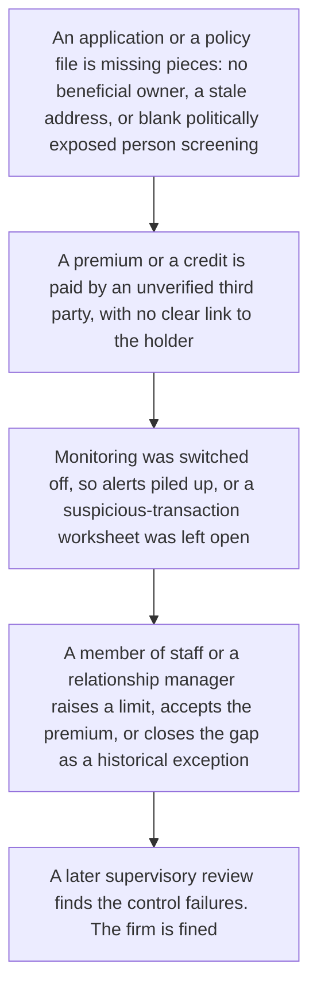
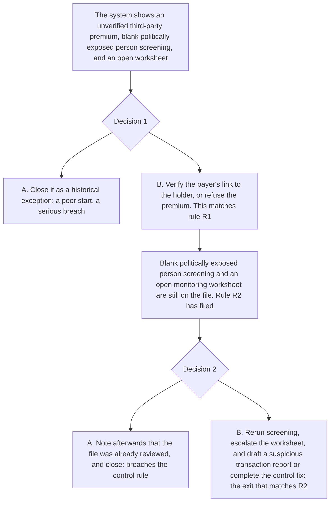

# 11. Insurer and bank control gaps

This page is for human review. It joins the control-review teaching of two playable scripts: [`data/cases/10-ia-fwd-controls-001.example.json`](../cases/10-ia-fwd-controls-001.example.json) (`hk-ia-fwd-controls-001`) and [`data/cases/11-hkma-cdd-001.example.json`](../cases/11-hkma-cdd-001.example.json) (`hk-hkma-cdd-001`). It is not a third script. The public-reporting notes are in [`data/cases/README.md`](../cases/README.md).

## Real-world flow

Method and logic: a firm, such as an insurer or a bank, leaves systematic gaps in its own controls. Ongoing monitoring stays off. Politically exposed person screening is blank. Suspicious-transaction worksheets stay open. An unverified third party pays a large premium or credits an account. A high-risk customer uses those gaps to place funds or to keep a relationship open.

The public-reporting notes for `hk-ia-fwd-controls-001` and `hk-hkma-cdd-001` are the inspiration. The scripts use a fictional insurer and a fictional bank. They are not those firms' customer files.

## Platform teaching flow

Trainee role: senior compliance reviewer at an insurer or a bank.

Training goal: hold the control line. An unverified third-party payment, blank screening, and an open monitoring worksheet cannot be closed as a historical exception or as a note written after the fact. The fix is to rerun the checks and to escalate.

The check is whether the trainee refuses a note written after the fact, and whether screening is rerun and the worksheet is escalated.

## Training matrix for cases 10 and 11

| Case | Trainee role | Decision question | What is marked |
| --- | --- | --- | --- |
| 10. Organised-crime cashflow | Senior compliance officer | Large cash flows have no commercial papers, and an organised-crime indicator is on the file. Can this be closed as an ordinary cash business? | Whether the oral excuse was refused, and whether payments were held and a freeze was recommended |
| 11. Firm control gaps, CDD and premiums | Senior compliance reviewer | A third-party premium, blank screening, and an open monitoring worksheet are on the file. Can this be closed as a historical exception? | Whether a note written after the fact was refused, and whether screening was rerun and the worksheet was escalated |
