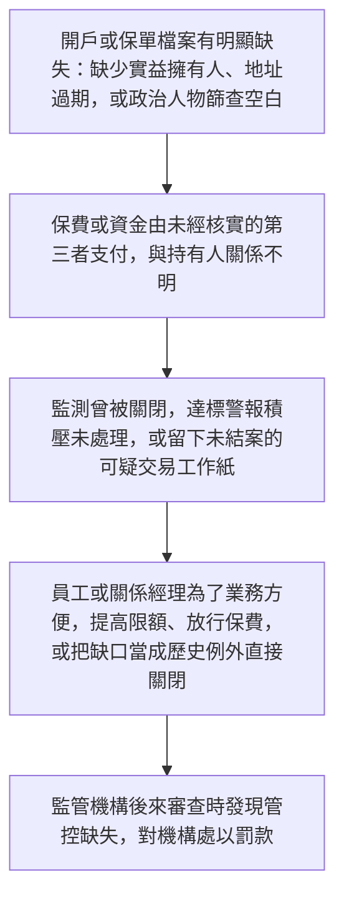
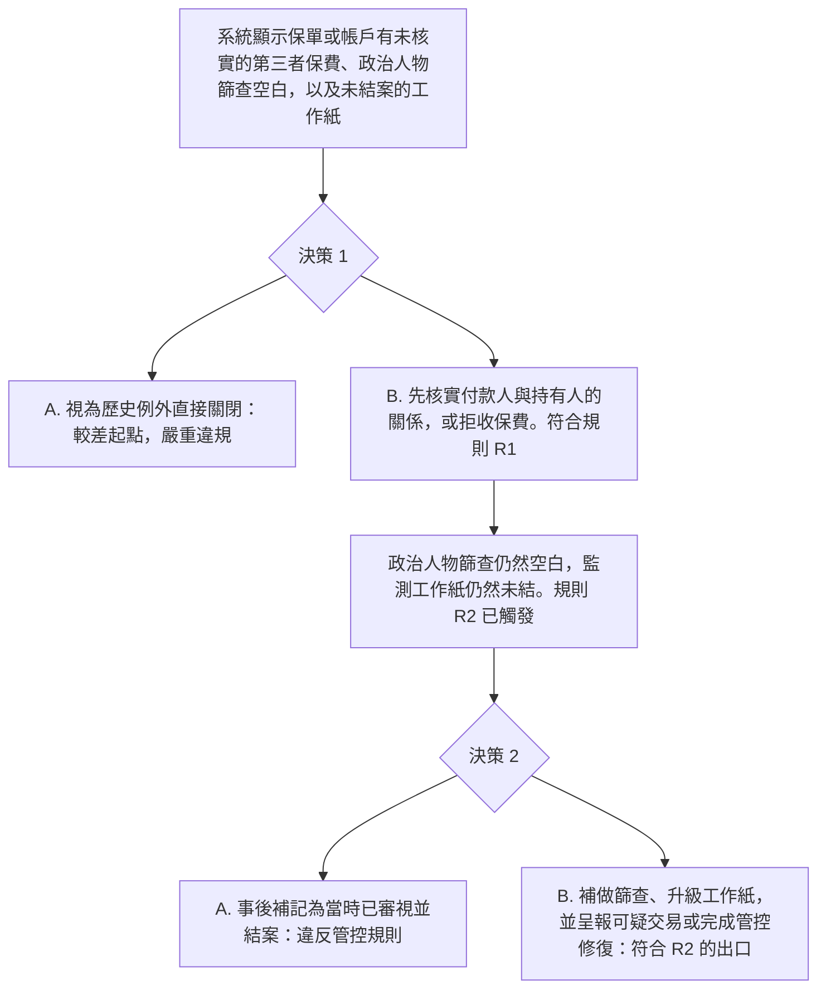

# 11. 保險與銀行的管控缺失

本頁供人閱讀。它把兩份可玩劇本的管控審查放在同一條教學流程：[`data/cases/10-ia-fwd-controls-001.example.json`](../cases/10-ia-fwd-controls-001.example.json)（`hk-ia-fwd-controls-001`）與 [`data/cases/11-hkma-cdd-001.example.json`](../cases/11-hkma-cdd-001.example.json)（`hk-hkma-cdd-001`）。這不是第三份劇本。公開報道的靈感說明在 [`data/cases/README.md`](../cases/README.md)。

## 現實運作流程

手法與邏輯：金融機構，例如保險公司或銀行，在自身合規上留下系統性缺口。持續監測長期關閉，政治人物篩查未完成，可疑交易工作紙未結案，未核實的第三者可以直接繳付大額保費或資金。高風險客戶利用這些死角完成投保、入帳或把關係維持下去。

`hk-ia-fwd-controls-001` 與 `hk-hkma-cdd-001` 的公開報道說明是靈感來源。劇本用的是虛構保險公司與虛構銀行，不是那些機構的客戶檔。

## 培訓平台教學流程

學員角色：保險或銀行的資深合規審查主任。

核心訓練目標：守住管控底線。未核實的第三者付款、空白篩查、未結的監測工作紙，不能以歷史例外或事後補記作結。必須補做檢查並升級。

檢視的是學員有否拒絕事後補記，以及有否重跑篩查並升級工作紙。

## 個案 10 至 11 的培訓對照

| 案例 | 學員角色 | 核心決策問題 | 關鍵考核 |
| --- | --- | --- | --- |
| 10. 有組織犯罪現金流 | 資深合規主任 | 面對沒有商業憑證的大額流水，以及有組織犯罪指標，能否當作普通現金生意結案？ | 有否拒絕口頭藉口，有否落實止付並建議凍結 |
| 11. 機構管控缺失，認識客戶與保費 | 資深合規審查主任 | 面對第三者保費、空白篩查與未結監測工作紙，能否當作歷史例外關閉？ | 有否拒絕事後補記，有否重跑篩查並升級工作紙 |
