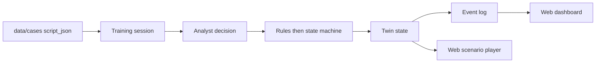
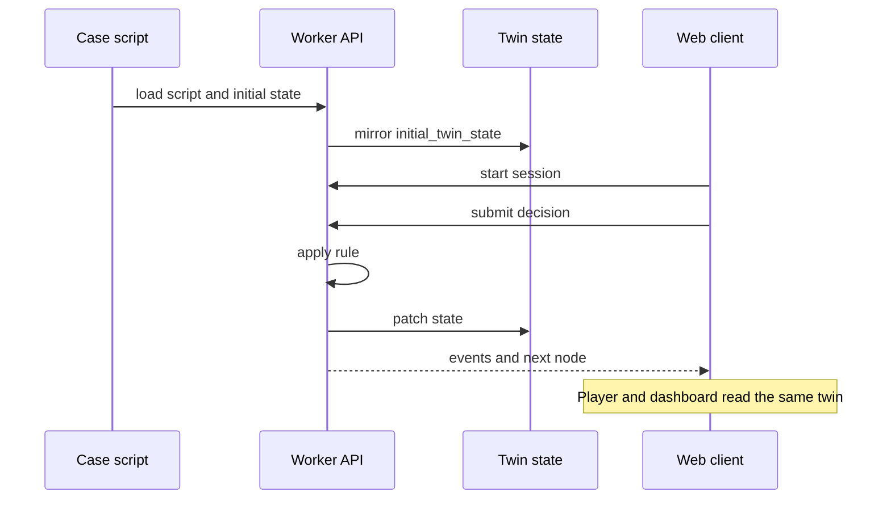

# TwinAML architecture (simplified)

TwinAML is a digital twin for training. It is not a bank production system. The twin lives in the backend: one case state, plus the events that change it. The web app is only the face. Unity can later be another face. It does not get a second copy of the state.

This demo stays one API and one web client on purpose. It does not split into microservices, and it does not use Neo4j, Kafka, Docker, or Kubernetes.

The primary runtime is one Node server in `workers/api`, with a file-backed SQLite database. It serves the built React interface from `frontend/dist/` and the investigation API on the same origin. The optional Cloudflare Worker adapter uses the same Hono routes, investigation engine, and content pack. FastAPI in `backend/` remains a health-only stub.

The playable investigation runtime is described under [Investigation pilot](#investigation-pilot). The eleven-script flow below records the original node/choice roadmap and remains planned.

## Planned node/choice flow

1. **Case** — `data/cases/*.json` loads one synthetic case.
2. **Script** — `nodes` are the scenario: scenes, decisions, and outcomes. `start_node_id` is the entry.
3. **Decision** — the trainee picks one `choice` on a decision node.
4. **Twin** — the state machine applies that choice's `effects` and the node's `twin_patch` to the twin state. Rules judge first. A model may explain only after that.
5. **Events** — each choice, override, and outcome is an event. The event sequence is the thread of that session.
6. **Dashboard** — the web app reads the same state and events for the player and a simple dashboard. The player does not keep a second source of truth.

The node/choice script flow above is not executed by the current pilot. Its historical Worker/Pages hosting target is optional; the current run path uses Node and SQLite on a VPS. Both follow the backend-state principle.

## What exists now

| Piece | Status |
| --- | --- |
| Script JSON and JSON Schema | Present. Eleven example cases. Effect keys are frozen in [`effects.md`](effects.md). |
| Node API | `workers/api/src/node-server.mjs` serves `GET /health`, paired-investigation session/action routes, and built frontend files. File-backed SQLite persists runs. |
| Optional Worker adapter | `workers/api/src/index.ts` uses the same routes and engine, with a SQLite-backed Durable Object per run. |
| FastAPI | Optional local Python stub. `GET /health` only. |
| Investigation state, sessions, event log | Implemented for `analyst-session-001`; the eleven node/choice scripts are not yet executed. |
| Web | Playable React investigation desk in `frontend/`. Node serves the production build; Vite proxies `/api` to Node during development. |
| `data/media/` | Only `.gitkeep` is tracked. `media_ref` values in a script point at local files. |

A node/choice rule's `when` text is a sentence for a person to read. The schema does not execute it. When that script engine is implemented, decide whether to replace those sentences with executable conditions. The current investigation engine uses its authored evidence and payment contract; it does not execute the eleven scripts.

## Planned node/choice state

In the planned script player, the session twin starts as a deep clone of `initial_twin_state`. Patches then accumulate on that clone. Full key rules, including every key used in the example cases, are in [`effects.md`](effects.md).

- **Initial mirror**: `initial_twin_state`.
- **Node patch**: on entry, apply `twin_patch` (for example, `phase` becomes `alert_triage`).
- **Decision effects**: after that patch, apply the chosen `choices[].effects`. Dotted keys write nested fields (`kyc.status`). `risk.flags_add` appends onto `risk.flags`. `risk.score_delta` adds to `risk.score`. Any other key replaces the value at that path.
- **Outcome**: `type: outcome` and `terminal: true`. The outcome `twin_patch` writes `disposition`, and the session ends.

Media is not in git. The `media_ref` on `n_intake` is `data/media/deepfake-001/kyc-clip.mp4`, and that file is excluded by `.gitignore`. When the clip is missing, the player should later show a missing-file state. It should not abort the whole case.

## Investigation pilot

`scripts/export-web-investigation.py` builds the server-only content bundle from the existing evidence pack and its validated CSV tables. It imports exact document text, profiles, alerts, transactions, request gates, initial balances, and pending-payment schedules. It never imports the instructor answer keys. The script format above remains unchanged.

The shared investigation engine is `workers/api/src/engine.ts`; shared Hono routes are in `workers/api/src/api.ts`. The Node adapter persists each run's authoritative snapshot and ordered events as JSON in a SQLite `sessions` table. Actions update it inside a transaction. Learner actions carry the revision they observed; stale actions are refused so two views cannot silently overwrite each other. The browser stores only its session identifier and local UI/draft state.

The default SQLite path is `data/local/investigation.sqlite`, configurable through `TWINAML_DB`. The Node server defaults to loopback port 8787 and serves `frontend/dist/`. For a VPS, run it behind an HTTPS reverse proxy and set `TWINAML_FRONTEND_ORIGIN` to the public origin. Build and hosting instructions are in [`vps.md`](vps.md) and [`../workers/api/README.md`](../workers/api/README.md).

The optional Worker adapter persists a run in one SQLite-backed Durable Object instead. The adapters share the engine and data contract, not a database; switching hosts does not transfer existing sessions. Use one adapter as the state owner for a deployment.

The guided clock follows the evidence/payment ordering in `simulation/flexsim/CONTRACT.md`: reading is paused, requested evidence arrives before actions at its completion minute, a hold at a payment's due minute takes effect before execution, and releasing a hold immediately checks strictly overdue orders. Decisions never place or release a hold. The web API has its own typed response/event fields; it does not claim byte-for-byte FlexSim trace compatibility.

Responses contain only evidence already available to the learner. Hidden record bodies, titles, request-to-record mappings and instructor paths stay server-side. The debrief uses observed requests, controls, decisions and payment consequences; it does not disclose case truth or produce an instructor score.

See [`arg-investigation.md`](arg-investigation.md) for the player experience, scope and content export.

## Clients

- **Now**: `frontend/`, React + Vite + TypeScript. The Node server serves the built investigation desk and API together. The browser reads learner-visible session state from that API. Pages hosting remains optional with the Worker adapter.
- **Later, optional**: a Unity client calling the same API. Do not add a Unity project until one is requested.

## Standalone FlexSim edition

[`simulation/flexsim/`](../simulation/flexsim/README.md) is a separate runtime, not another client of the web API. It runs the analyst investigation exercise from the evidence pack `data/evidence/analyst-session-001/` inside FlexSim, where Global Tables and FlexScript own the run state for that edition only. It follows one deterministic contract (`simulation/flexsim/CONTRACT.md`): snapshot tables plus an event log, with a Python reference harness that reproduces the same traces on the Mac for verification.

It shares no state with the web API and does not call it. For the web demo, the API is the single state owner, and the web app renders its state. The FlexSim edition is authored on macOS and is unverified in FlexSim at the time of writing.

## Explicitly out of scope

Neo4j, Kafka, Docker, Kubernetes, a multi-service split, a live core-banking connection, a language model that issues the compliance result directly, and committing large mp4 files to git.
