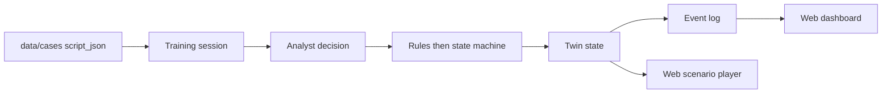

# TwinAML architecture (simplified)

TwinAML is a digital twin for training. It is not a bank production system. The twin lives in the backend: one case state, plus the events that change it. The web app is the face. The Unity Editor room is the immersive face and is in scope for the demo. Neither face gets a second copy of the state.

This demo stays one API and one web client on purpose. It does not split into microservices, and it does not use Neo4j, Kafka, Docker, Kubernetes, or FlexSim.

The COMP3424 demo runs on a self-hosted Linux VPS. FastAPI in `backend/` is the API process. The Vite build in `frontend/` is the static site. nginx or Caddy terminates HTTPS. See [`deploy-vps.md`](deploy-vps.md). A Node/Hono process may serve the same routes later. `workers/api` is a legacy Cloudflare Worker scaffold and is not the deployed demo.

## How one training run moves

1. **Case** — `data/cases/*.json` loads one synthetic case.
2. **Script** — `nodes` are the scenario: scenes, decisions, and outcomes. `start_node_id` is the entry.
3. **Decision** — the trainee picks one `choice` on a decision node.
4. **Twin** — the state machine applies that choice's `effects` and the node's `twin_patch` to the twin state. Rules judge first. A model may explain only after that.
5. **Events** — each choice, override, and outcome is an event. The event sequence is the thread of that session.
6. **Dashboard** — the web app reads the same state and events for the player and a simple dashboard. The player does not keep a second source of truth.

Those routes live on the FastAPI process: `GET /cases`, `POST /sessions`, `GET /sessions`, `GET /sessions/{id}`, `POST /sessions/{id}/decisions`, and `GET /sessions/{id}/evidence`. `GET /health` stays. The legacy Worker still exposes only the health check. It is not where sessions go.

## What exists now

| Piece | Status |
| --- | --- |
| Script JSON and JSON Schema | Present. Eleven example cases. Effect keys are frozen in [`effects.md`](effects.md). |
| FastAPI | `backend/`. Health, case list, sessions, decisions, events, and the twin. |
| Legacy Cloudflare Worker | `GET /health` in `workers/api`. Scaffold only. Not the demo deploy. |
| State machine, sessions, event log | `backend/app/machine.py` applies patches. Sessions and events are rows in `data/local/sessions.sqlite` on the API machine. |
| Web player and dashboard | `frontend/`. Both read the API twin. |
| `data/media/` | Only `.gitkeep` is tracked. `media_ref` values in a script point at local files. |

A rule's `when` text is a sentence for a person to read. The schema does not execute it, and the state machine does not either. Outcomes still come from the script's patches. Do not invent a second script format beside this one.

## Where state lives

One session is one row in `data/local/sessions.sqlite`. The API machine is the only host for that file. A restart keeps the rows. Closed rows older than 7 days are removed, and the file holds at most 2000 sessions. Details and the environment overrides are in [`backend/README.md`](../backend/README.md).

The session twin starts as a deep clone of `initial_twin_state`. Patches then accumulate on that clone. Full key rules, including every key used in the example cases, are in [`effects.md`](effects.md).

- **Initial mirror**: `initial_twin_state`.
- **Node patch**: on entry, apply `twin_patch` (for example, `phase` becomes `alert_triage`).
- **Decision effects**: after that patch, apply the chosen `choices[].effects`. Dotted keys write nested fields (`kyc.status`). `risk.flags_add` appends onto `risk.flags`. `risk.score_delta` adds to `risk.score`. Any other key replaces the value at that path.
- **Outcome**: `type: outcome` and `terminal: true`. The outcome `twin_patch` writes `disposition`, and the session ends.

Media is not in git. The `media_ref` on `n_intake` is `data/media/deepfake-hk-001/kyc-clip.mp4`, and that file is excluded by `.gitignore`. When the clip is missing, the player shows a missing-file state and the case continues.

## Clients

- **Web**: `frontend/`, React + Vite + TypeScript, static files on the Linux VPS. The scenario player and the dashboard read twin state from the API.
- **Editor room**: [`unity/UNITY.md`](../unity/UNITY.md). In scope. Unity 6000.6.8f1, first scene `Scn_Branch_Lobby`. It applies the schema 0.1 patches locally while you play Topics 1–4. That mirror is the training-room twin for the Editor dashboard. It is not a second case format, and it does not call the session API. Wiring that room to the API is P3-S4.

## Explicitly out of scope

Neo4j, Kafka, Docker, Kubernetes, FlexSim, a multi-service split, a live core-banking connection, a language model that issues the compliance result directly, and committing large mp4 files to git. The Unity Editor room stays in the demo. A second Unity project does not.
