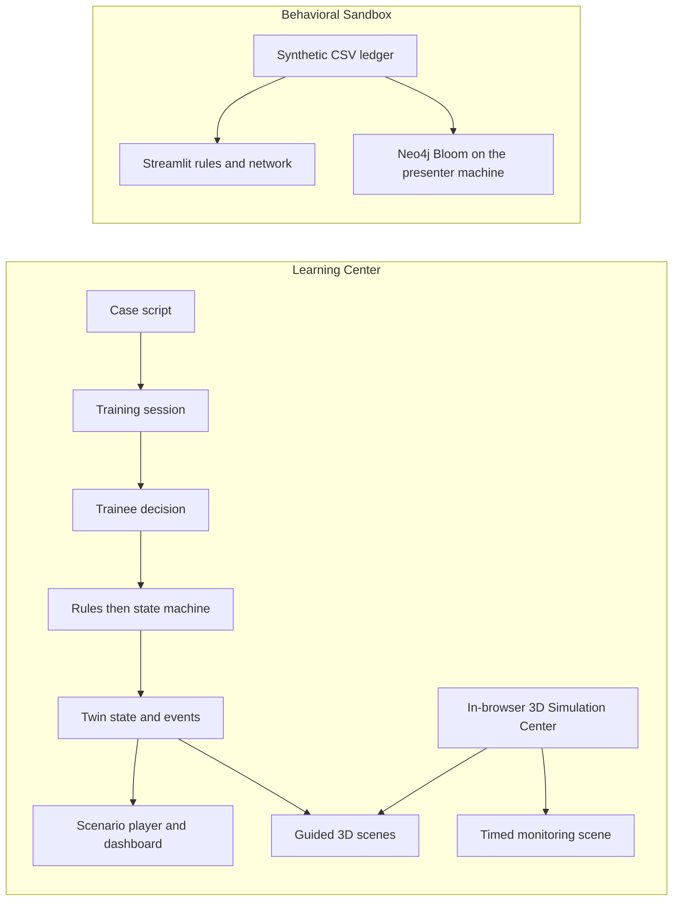

# TwinAML architecture (simplified)

TwinAML is a digital twin for AML simulation training. It is not a bank production system. The classroom demo has two parts, and they do not share a store.

The **Learning Center** is the web shell on a rented Linux VPS. For a scripted case, the twin lives in the API: one case state, plus the events that change it. The web client renders that state. It does not keep a private copy of the case world.

The **Behavioral Sandbox** in [`demo/neo4j/`](../demo/neo4j/README.md) is the other classroom piece. Streamlit reads a bundled CSV ledger. Neo4j Bloom is the graph view of that same ledger on the presenter's machine. The sandbox does not write the Learning Center session store. There is no live bank connection.

The development Learning Center is [https://dev-amltwin.spectrumvps.tech/](https://dev-amltwin.spectrumvps.tech/) (page `/simulations`). The HTML sets `twinaml-environment` to `development`, `twinaml-release` to `20261109T064146Z`, and `robots` to noindex. Release `20261109T064146Z` is ahead of this `main` tree. The gap is under [Linux VPS Platform (Learning Center)](#linux-vps-platform-learning-center).

The public project repository is [https://github.com/innalhy/aml-twin](https://github.com/innalhy/aml-twin). It is also where the project is managed.

## How one training run moves

The two subgraphs do not connect. Guided 3D scenes on the live site read the Learning Center case and session APIs. The timed monitoring scene does not. The Three.js client is on the current VPS deploy. It is not in `frontend/src/` on this branch.

1. **Case** — `data/cases/index.json` names 13 synthetic scripts. The API in this tree loads the script a `case_id` names and checks its sha256. The live `GET /api/cases` lists a different set of 13 cases across 11 workflows, including `bank-cdd-001` and `mule-rent-001`. The root [README](../README.md) lists those live ids.
2. **Script** — `nodes` are the scenario: scenes, decisions, and outcomes. `start_node_id` is the entry.
3. **Decision** — the trainee picks one `choice` on a decision node.
4. **Twin** — the state machine applies that choice's `effects` and the node's `twin_patch` to the twin state. Explicit rules and the state machine set `disposition`. An LLM must not set the case outcome at runtime.
5. **Events** — each choice, override, and outcome is an event. The event sequence is the thread of that session.
6. **Dashboard** — the web app in this tree reads the same state and events for the player and a simple dashboard. The player does not keep a second source of truth.

Routes declared in `backend/app/main.py` on this branch: `GET /cases`, `POST /sessions`, `GET /sessions`, `GET /sessions/{id}`, `POST /sessions/{id}/decisions`, and `GET /sessions/{id}/evidence`. `GET /health` returns `{"status":"ok","service":"twinaml-api"}`. The web client in this tree sends `cache: no-store` on `/sessions` reads. A second click while a start or a decision is in flight is ignored, and the case list changes the hash only while that list is still showing. The dashboard renders every session `GET /sessions` returns. The audit card loads after the session view.

`workers/` may remain as a legacy scaffold. It is not where sessions go.

## Linux VPS Platform (Learning Center)

The Learning Center runs on a rented Linux VPS. A reverse proxy, nginx or Caddy, terminates HTTPS, serves the static React build, and forwards API paths to FastAPI on localhost. See [`deploy-vps.md`](deploy-vps.md).

| Piece | On the current VPS (release `20261109T064146Z`) | In this `main` tree |
| --- | --- | --- |
| Web client | React 19 + Vite SPA. The bundle lazy-loads `SceneViewport` and `TwinPlatform`. | `frontend/`. React 19 + Vite. `frontend/package.json` has no `three` dependency. `frontend/src/` is the case list, scenario player, and dashboard. |
| 3D Simulation Center | Page `/simulations`. Three.js WebGL canvas. Component `SceneViewport` (chunk `assets/SceneViewport-*.js`). Three scenes, below. | Not in this tree. |
| Session API | FastAPI. `GET /health` returns `{"status":"ok","service":"twinaml-api"}`. The live bundle calls `/api/cases`, `/api/sessions`, and `/api/case-sessions`. | `backend/app/main.py` declares the unprefixed routes listed above. It does not declare `POST /api/aml-simulations`, `/api/aml-sessions`, or `GET /api/twin`. |
| Session store | SQLite, through Python stdlib `sqlite3`. | `backend/app/sessions.py`. Default path `data/local/sessions.sqlite` (gitignored). Override with `TWINAML_SESSIONS_DB`. `backend/requirements.txt` has no PostgreSQL, Redis, or MySQL driver. |
| AML Process Twin | `GET /api/twin` returns `{"enabled":true}`. The bundle includes `TwinPlatform` on `/twin` and `/operations`. | Not in this tree. This repo does not show a runtime data connection from that client to Streamlit or Neo4j. |
| Account | Clerk appears in the live JS bundle. `GET /api/account` returns `{"enabled":false,"configured":false,"user":null}`. | Clerk is not an enabled auth stack. This tree has no auth module. |
| Behavioral Sandbox | Streamlit may run on the VPS or on the presenter's laptop. This repo does not publish a Streamlit hostname. Bloom stays on the presenter's machine. | `demo/neo4j/`. |

### In-browser 3D Simulation Center

The page `/simulations` offers three Interactive 3D scenes. They run in the browser. They are a Three.js canvas inside the Learning Center web client. Rooms and furniture are Three.js primitives (`BoxGeometry`, `PlaneGeometry`, and others). There are no `.glb` or `.gltf` model files. A Unity loader under `/Build/*.loader.js` returns 404. `/webgl/` and `/unity/Build/` are not a Unity player.

| Scene | Room | How it runs |
| --- | --- | --- |
| Client onboarding & due diligence | Private banking office | Guided case `bank-cdd-001`. Uses the Learning Center case and session APIs. |
| Branch suspicious activity review | Retail branch | Guided case `mule-rent-001`. Uses the Learning Center case and session APIs. |
| Transaction monitoring & investigation | Transaction monitoring operations | Timed simulation. `caseId` is null. The live client calls `POST /api/aml-simulations` and `/api/aml-sessions/{id}` (and `/actions`). Those routes exist on the current VPS deploy. They are not in `backend/app/` on this branch. This page does not name source files for them. |

Drag inside the scene to look around. Pinch or use the zoom controls. The arrow keys move the view. Numbered hotspot pins open the related station. If WebGL is unavailable, the canvas says: “3D view is unavailable here. Use the stations below to continue.”

This 3D view is a browser scene inside the Learning Center. It is not a 3D office digital twin of a workplace. It does not replace the Behavioral Sandbox. Unity, Unreal, Omniverse, and FlexSim are not this path. The Unity Editor project remains only on branch [`unity`](https://github.com/innalhy/aml-twin/tree/unity) and is outside the current demo path. This branch does not contain `unity/`.

## What exists in this tree

| Piece | Status |
| --- | --- |
| Script JSON and JSON Schema | Present. Thirteen scripts in `data/cases/`, named by `index.json`. Effect keys are frozen in [`effects.md`](effects.md). |
| FastAPI | `backend/`. Health, case list, sessions, decisions, events, and the twin. The live `/api/aml-simulations`, `/api/aml-sessions`, and `/api/twin` routes are not declared here. |
| Session store | `backend/app/sessions.py` uses Python stdlib `sqlite3`. Rows live in `data/local/sessions.sqlite` on the API machine. |
| Web player and dashboard | `frontend/`. Both read the API twin. No `three` dependency, and no `SceneViewport` source. |
| Behavioral Sandbox | `demo/neo4j/`. Streamlit, the CSV ledger, Cypher, and Bloom notes. |
| `workers/` | Legacy scaffold. Not the demo path. |
| `data/media/` | Only `.gitkeep` is tracked. `media_ref` values in a script point at local files. |

A rule's `when` text is a sentence for a person to read. The schema does not execute it, and the state machine does not either. Outcomes still come from the script's patches. Do not invent a second script format beside this one.

## Where state lives

One session is one row in `data/local/sessions.sqlite`. The API machine is the only host for that file. A restart keeps the rows. Closed rows older than 7 days are removed, and the file holds at most 2000 sessions. Details and the environment overrides are in [`backend/README.md`](../backend/README.md). The override for the file path is `TWINAML_SESSIONS_DB`.

The session twin starts as a deep clone of `initial_twin_state`. Patches then accumulate on that clone. Full key rules, including every key used in the example cases, are in [`effects.md`](effects.md).

- **Initial mirror**: `initial_twin_state`.
- **Node patch**: on entry, apply `twin_patch` (for example, `phase` becomes `alert_triage`).
- **Decision effects**: after that patch, apply the chosen `choices[].effects`. Dotted keys write nested fields (`kyc.status`). `risk.flags_add` appends onto `risk.flags`. `risk.score_delta` adds to `risk.score`. Any other key replaces the value at that path.
- **Outcome**: `type: outcome` and `terminal: true`. The outcome `twin_patch` writes `disposition`, and the session ends.

Media is not in git. The `media_ref` on `n_intake` is `data/media/deepfake-hk-001/kyc-clip.mp4`, and that file is excluded by `.gitignore`. When the clip is missing, the player shows a missing-file state and the case continues.

## Clients

- **Web in this tree**: `frontend/`, React 19 + Vite + TypeScript, static files for the Linux VPS. The scenario player and the dashboard read twin state from the API.
- **3D Simulation Center**: Three.js inside the live Learning Center, described above. The source is not in `frontend/src/` on this branch.
- **Behavioral Sandbox**: `demo/neo4j/`. Streamlit on the VPS or the presenter's laptop. Bloom on the presenter's machine. It does not write `sessions.sqlite`.
- **Unity Editor project**: branch [`unity`](https://github.com/innalhy/aml-twin/tree/unity) only. Outside the current demo path. It is not the in-browser 3D view.

## Explicitly out of scope

Docker, Kubernetes, Kafka, FlexSim, a multi-service split, PostgreSQL, Redis, MySQL, a live core-banking connection, a language model that sets the compliance result, and committing large mp4 files to git. Neo4j belongs to the Behavioral Sandbox. It is the graph view of the bundled ledger, on the presenter's machine. Unity, Unreal, and Omniverse are not the current 3D path.
