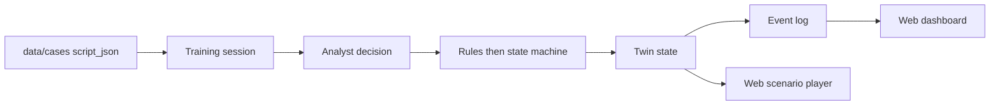
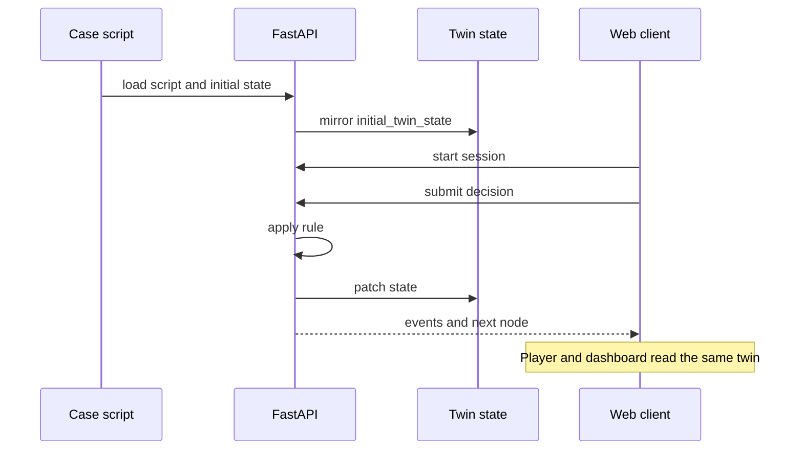

# TwinAML 架構（簡化）

TwinAML 是一個培訓用數位孿生，不是銀行生產系統。孿生本體在後端：一份案例狀態，加上會改變它的事件。Web 只是臉。Unity 之後可以換一張臉，不另做一套狀態。

這個 demo 故意保持單應用。不拆微服務，不接 Neo4j 或 Kafka。

## 一條培訓是怎麼走的

1. **Case** — `data/cases/*.json` 載入一宗合成案例。
2. **Script** — `nodes` 是劇本：場景、決策、結局。`start_node_id` 是入口。
3. **Decision** — 學員在決策節點選一個 `choice`。
4. **Twin** — 狀態機把該選項的 `effects` 和節點的 `twin_patch` 打進孿生狀態。規則先判斷，模型以後才可以解釋。
5. **Events** — 每一次選擇、覆寫、結局都是事件。事件序列就是這次 session 的 thread。
6. **Dashboard** — Web 讀同一份狀態與事件，給播放器與簡單儀表板。播放器不另存一份真相。

## 現在實際有什麼

| 部分 | 狀態 |
| --- | --- |
| 劇本 JSON 與 JSON Schema | 有。見 `deepfake-hk-001.example.json` |
| FastAPI | 只有 `GET /health` |
| 狀態機、session、事件紀錄 | 未做 |
| Web 播放器與儀表板 | 未做。`frontend/` 是可啟動的佔位頁 |
| `data/media/` | 只追蹤 `.gitkeep`。劇本裡的 `media_ref` 指向本機檔案 |

規則的 `when` 目前是給人讀的句子，schema 不執行它們。等狀態機寫出來，再決定要不要換成可執行的條件。在那之前不要平行發明第二套劇本格式。

## 狀態住在哪

- **初始鏡像**：`initial_twin_state`。載入案例時，孿生等於這份物件。
- **節點補丁**：進入節點時的 `twin_patch`（例如階段改成 `alert_triage`）。
- **決策效果**：`choices[].effects`。鍵是約定（如 `risk.flags_add`），還不是正式 DSL。
- **結局**：`type: outcome` 且 `terminal: true`。`disposition` 寫進孿生，session 結束。

媒體不在 git。`n_intake` 的 `media_ref` 是 `data/media/deepfake-hk-001/kyc-clip.mp4`，檔案被 `.gitignore` 排除。沒有影片時，播放器之後應顯示缺檔，而不是中斷整個案例。

## 客戶端

- **現在**：`frontend/`，React + Vite + TypeScript。目標畫面是劇本播放器加上一個讀孿生狀態的簡單儀表板。
- **以後可選**：Unity 客戶端呼叫同一個 API。未要求之前不要加 Unity 專案。

## 明確不做

Neo4j、Kafka、多服務拆分、真實核心銀行連線、以語言模型直接給合規結論、把大型 mp4 提交進 git。
