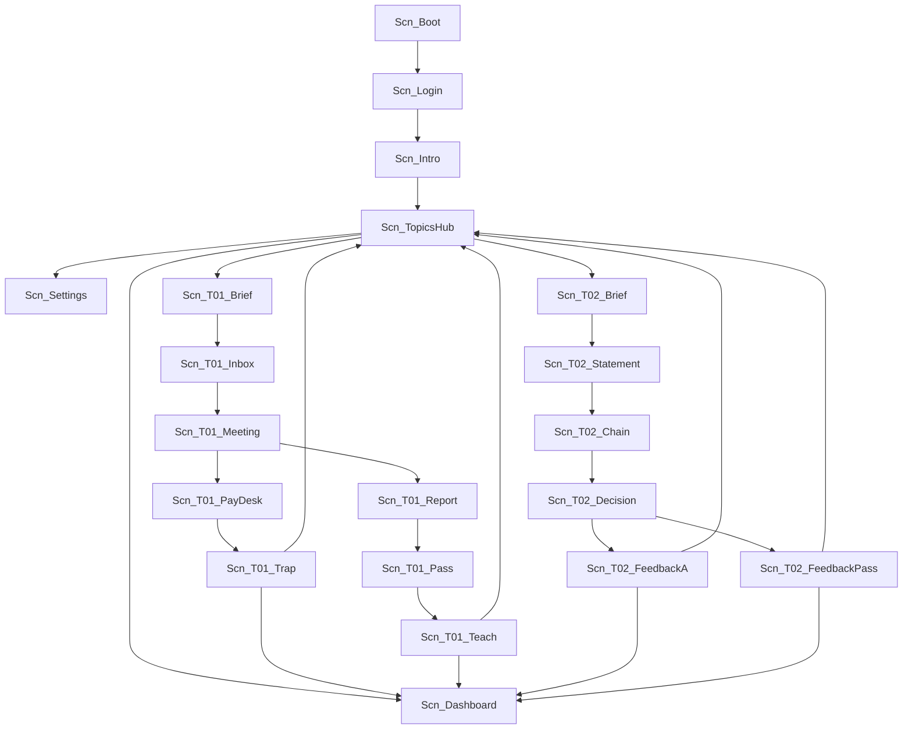

# TwinAML Unity training room

Immersive Editor face for COMP3424. The office is the training room. Wall panels are the exercise. The Worker and the web app stay the later home for rules. This room does not call the Worker, and it does not start P1-S2.

Phase 1 content is pre-authored. There is no live video generation and no bank connection. Every screen says the interface is synthetic.

## Open it

1. Install **Unity 2022.3 LTS** (this project was written for 2022.3.62f1). Unity 6 can open the same folder and may ask to upgrade. Allow the upgrade if you want. Do not add a render-pipeline package unless you mean to.
2. **Add** or **Open** the project folder `unity/TwinAML` (the folder that contains `Assets` and `ProjectSettings`).
3. The pipeline is the **Built-in Render Pipeline**, so the first Play is not a pink URP screen. To move to URP later: install Universal RP, create a pipeline asset, and assign it under Project Settings → Graphics.
4. First scene: **`Scn_Boot`**. It is scene 0 in Build Settings. Menu: **TwinAML → Play From Boot**. Or open `Assets/Scenes/Scn_Boot.unity` and press Play.
5. On the first Editor open, **TwinAML → Sync Scenes Into Build Settings** runs by itself and keeps every `Scn_*` scene in the build.

Docker is not used.

Case JSON is read from `data/cases/` next to this Unity project (`Application.dataPath/../../../data/cases`). Do not copy the scripts into the Unity folder. A missing file is shown on the brief panel. The exercise does not invent a second script format.

## What Play does

`FlowController` is created when you press Play. It loads the scene you are in, or `Scn_Boot` if the open scene is not one of ours. UI is built in code (uGUI), so the `.unity` files only need a camera and a light. If a scene is missing from Build Settings, the same controller stays on the current scene and swaps panels. With the build list in place, it calls `SceneManager.LoadScene` for the scene id.

Sign in with any display name. It is stored only in the local dashboard snapshot.

| Step | Scene |
| --- | --- |
| Boot | `Scn_Boot` |
| Sign-in | `Scn_Login` |
| Room note | `Scn_Intro` |
| Topics | `Scn_TopicsHub` |
| Empty or filled dashboard | `Scn_Dashboard` |
| Language | `Scn_Settings` |

Both **Start** buttons on the hub are orange `#f5a524`.

## Scene map



## Topics and case ids

| Topic | case_id | File | Pedagogy |
| --- | --- | --- | --- |
| T01 Deepfake | `deepfake-hk-001` | `data/cases/01-deepfake-hk-001.example.json` | Trap = confirm the payment. Pass = withhold trust and report (暫停並舉報). |
| T02 Mule and mixer | `hk-greythunder-mule-001` | `data/cases/06-greythunder-mule-001.example.json` | A = miss. B / C / D = pass: enhanced due diligence, outbound hold, draft STR. |

T02 uses the mule-cluster script. The chain panel also draws the mixer picture from [`data/case-flow/02-crypto-mixers-mule-accounts.en.md`](../data/case-flow/02-crypto-mixers-mule-accounts.en.md). That picture is teaching context. It is not a second script, and it does not add effect keys. `hk-justicegate-crypto-001` is the nearby cash-and-OTC script and is not the one this room plays.

### Choice → frozen script path

The room logs the button id, the time the decision panel was shown, and the time you pressed it. It then plays the script choice ids below with the schema 0.1 applier (`docs/effects.md`): clone `initial_twin_state`, apply each `twin_patch` on entry, then apply that choice's `effects`.

| Button | Script choices | Disposition | Grade |
| --- | --- | --- | --- |
| T01 Confirm payment | `pass_video`, `clear_alert` | `false_positive_cleared` | Trap. Funds at risk. |
| T01 Hold and report | `redo_liveness`, `follow_r1` | `blocked_by_rule` | Pass. Account stays closed. |
| T02 A Close as a normal investment | `release_friend`, `clear_friend` | `false_positive_cleared` | Trap. Skips the story node. |
| T02 B Enhanced due diligence | `edd_cluster`, `hold`, `exit_rel` | `account_exit` | Pass. |
| T02 C Hold outbound payments | `restrict`, `hold`, `exit_rel` | `account_exit` | Pass. |
| T02 D Draft an STR | `edd_cluster`, `hold`, `str_freeze` | `freeze_recommended` | Pass. STR drafted. |

Check the six paths from the repo root:

```bash
node scripts/unity-room-paths.test.mjs
```

T01's pass records `called_back` and `dual_approval` on the session because you refused a single approval from the video. The frozen script does not draft an STR on that ending: rule R1 stops onboarding before an account exists. The teach panel says so. Drafting an STR is T02 D. STR means a suspicious transaction report. In Hong Kong practice it is filed with the Joint Financial Intelligence Unit. This room only writes a draft flag onto the synthetic twin.

T02 B and C both end as `account_exit`, which this script lists as acceptable. They differ in flags: B orders enhanced due diligence (`EDD_ORDERED`); C places the outbound hold first and does not.

## Twin state and the dashboard

The mirror is the cloned script state plus patches. These four dashboard fields are written from that mirror and from the room choice. They are not extra keys in the case file.

| Field | When it is true |
| --- | --- |
| `funds_risk` | The disposition is in `teaching.poor_dispositions`, or `R2_IGNORED` is on the mirror. |
| `called_back` | The T01 pass (independent callback instead of paying from the video). |
| `dual_approval` | The room choice marks dual control, or `account.holds` contains `outbound`. |
| `str_filed` | `STR_DRAFTED` is on the mirror, or the disposition is `str_drafted`, `freeze_recommended`, or `cdd_refreshed_and_str`. |

Before any choice, the dashboard is empty: trap rate (出錯率) and reaction time stay blank. After a choice, the room appends the session and writes `twinaml-dashboard.json` under `Application.persistentDataPath`. The dashboard reads that list: disposition, flags, risk score, the four fields, choice id, script choice ids, and reaction time in milliseconds. Trap rate is completed traps divided by completed exercises.

The meeting panel has a video slot for `media_ref` (`data/media/deepfake-hk-001/kyc-clip.mp4`). If the file is absent, the slot says so and the exercise continues. Phase 1 does not generate a clip.

## Language

The header switches **English** and **繁體中文**. Chinese copy is formal written Traditional Chinese for a bank compliance room, not spoken Cantonese. Script prompts stay in the Traditional Chinese of the case file either way. The embedded font is a subset of WenQuanYi Micro Hei (Apache 2.0) so those characters can draw without a local CJK install. See `Assets/Fonts/NOTICE.txt`.

## What this folder does not do

- It does not change `packages/schemas/script.schema.json` or the eleven case files.
- It does not implement Worker routes or P1-S2.
- It does not connect to a bank, HKMA, or the JFIU.
- It does not require Docker.
