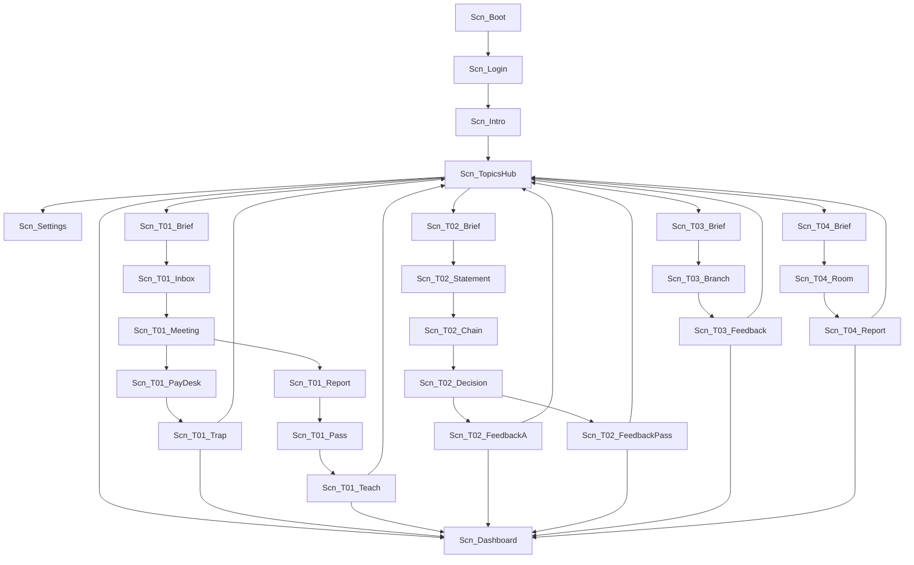

# TwinAML Unity training room

Immersive Editor face for COMP3424. The office is the training room. Wall panels are the exercise. This room is in scope for the demo. The VPS web app is the other face. This room does not call the API, and it does not start P1-S2.

Phase 1 content is pre-authored. There is no live video generation and no bank connection. Every screen says the interface is synthetic.

## Open it

1. Install **Unity 2022.3 LTS** (this project was written for 2022.3.62f1). The folder on disk is now Unity 6000.6.8f1. Unity 6 can open the same folder and may ask to upgrade. Allow the upgrade if you want. Do not add a render-pipeline package unless you mean to. `UnityEngine.UI` and `UnityEngine.EventSystems` (`Text`, `Button`, `EventSystem`) come from `com.unity.ugui` 2.6.0 in `Packages/manifest.json`. That is the built-in uGUI package shipped with 6000.6.8f1. `com.unity.modules.ui` is a different module and does not contain those types.
2. **Add** or **Open** the project folder `unity/TwinAML` (the folder that contains `Assets` and `ProjectSettings`).
3. The pipeline is the **Built-in Render Pipeline**, so the first Play is not a pink URP screen. To move to URP later: install Universal RP, create a pipeline asset, and assign it under Project Settings → Graphics.
4. First scene: **`Scn_Boot`**. It is scene 0 in Build Settings. Menu: **TwinAML → Play From Boot**. Or open `Assets/Scenes/Scn_Boot.unity` and press Play.
5. On the first Editor open, **TwinAML → Sync Scenes Into Build Settings** runs by itself and keeps every `Scn_*` scene in the build.

Docker is not used.

Case JSON is read from `data/cases/` next to this Unity project (`Application.dataPath/../../../data/cases`). Do not copy the scripts into the Unity folder. A missing file is shown on the brief panel. The exercise does not invent a second script format.

## What Play does

`FlowController` is created when you press Play. It loads the scene you are in, or `Scn_Boot` if the open scene is not one of ours. UI is built in code (uGUI), so the `.unity` files only need a camera and a light. If a scene is missing from Build Settings, the same controller stays on the current scene and swaps panels. With the build list in place, it calls `SceneManager.LoadScene` for the scene id.

Sign in with any display name. It is stored only in the local dashboard snapshot.

| Step | Scene |
| --- | --- |
| Boot | `Scn_Boot` |
| Sign-in | `Scn_Login` |
| Room note | `Scn_Intro` |
| Topics | `Scn_TopicsHub` |
| AML Training Portal | `Scn_Dashboard` |
| Language | `Scn_Settings` |

Both **Start** buttons on the hub are orange `#f5a524`.

Boot, sign-in, the room note, the hub, settings, and both topics use the same chrome as the training portal: a navy header with the TwinAML mark and the title TwinAML — AML Training Portal, a synthetic-training strip, a light gray page, and white rounded cards in a centered column. Forward actions are blue `#2f6fed`. Back actions are a lighter blue. Trap choices stay red and pass choices stay green, so the grade is still visible on the light page.

Topic panels add a step line under that strip. The current step is blue and bold. Earlier steps are green. Later steps are gray. A thin bar fills up to the current step.

| Topic | Steps | Scenes on the highlighted step |
| --- | --- | --- |
| Topic 1 | Brief → Inbox → Meeting → Decision → Feedback | Decision is the payment desk or hold-and-report. Feedback is the trap, the pass, and the teach panel. |
| Topic 2 | Brief → Statement → Chain → Decision → Feedback | Feedback is either miss or pass. |

## Scene map



## Topics and case ids

| Topic | case_id | File | Pedagogy |
| --- | --- | --- | --- |
| T01 Deepfake | `deepfake-hk-001` | `data/cases/01-deepfake-hk-001.example.json` | Trap = confirm the payment. Pass = withhold trust and report (暫停並舉報). |
| T02 Mule and mixer | `hk-greythunder-mule-001` | `data/cases/06-greythunder-mule-001.example.json` | A = miss. B / C / D = pass: enhanced due diligence, outbound hold, draft STR. |
| T03 Company onboarding | `hk-starlight-onboard-001` | `data/cases/12-starlight-onboard-001.example.json` | Open on the surface file, or documents only = miss. Enhanced due diligence, compliance referral, or refusal = pass. The lesson on screen is English. |
| T04 Alert triage | `alert-triage-shift-001` | `data/cases/13-alert-triage-shift-001.example.json` | One English investigation room, six synthetic alerts. Close any file, or draft an STR on the name-only screening hit, and the shift fails. A pass is a room score of 60 or more with neither of those. `shift_reviewed` only means the six choices were written down. |

T02 uses the mule-cluster script. The chain panel also draws the mixer picture from [`data/case-flow/02-crypto-mixers-mule-accounts.en.md`](../data/case-flow/02-crypto-mixers-mule-accounts.en.md). That picture is teaching context. It is not a second script, and it does not add effect keys. `hk-justicegate-crypto-001` is the nearby cash-and-OTC script and is not the one this room plays.

### Choice → frozen script path

The room logs the button id, the time the decision panel was shown, and the time you pressed it. It then plays the script choice ids below with the schema 0.1 applier (`docs/effects.md`): clone `initial_twin_state`, apply each `twin_patch` on entry, then apply that choice's `effects`.

| Button | Script choices | Disposition | Grade |
| --- | --- | --- | --- |
| T01 Confirm payment | `pass_video`, `clear_alert` | `false_positive_cleared` | Trap. Funds at risk. |
| T01 Hold and report | `redo_liveness`, `follow_r1` | `blocked_by_rule` | Pass. Account stays closed. |
| T02 A Close as a normal investment | `release_friend`, `clear_friend` | `false_positive_cleared` | Trap. Skips the story node. |
| T02 B Enhanced due diligence | `edd_cluster`, `hold`, `exit_rel` | `account_exit` | Pass. |
| T02 C Hold outbound payments | `restrict`, `hold`, `exit_rel` | `account_exit` | Pass. |
| T02 D Draft an STR | `edd_cluster`, `hold`, `str_freeze` | `freeze_recommended` | Pass. STR drafted. |
| T03 Open the account | `open_now` | `false_positive_cleared` | Trap. Account opened on an unfinished file. |
| T03 Documents only | `request_docs` | `cdd_incomplete` | Trap. Papers were requested. Enhanced due diligence was not. |
| T03 Enhanced due diligence | `order_edd` | `edd_hold` | Pass. The result this lesson wants. Account stays unopened. |
| T03 Tell compliance | `report_hold` | `str_drafted` | Pass. Draft flag only. This room does not contact the JFIU. |
| T03 Refuse | `refuse_relationship` | `onboarding_rejected` | Pass. Allowed when CDD cannot be completed. Record why. |
| T04 Recommended shift | `a1_escalate`, `a2_report`, `a3_more`, `a4_escalate`, `a5_more`, `a6_report` | `shift_reviewed` | Room pass when the score is 60 or more and neither hard fail fires. Script risk score 120. |
| T04 All closed | `a1_close` … `a6_close` | `shift_reviewed` | Room fail. Closing any of the six is a hard fail. Script risk score 0. No `STR_DRAFTED`. |

The Topic 4 room may file the six alerts in any order. When the shift is filed, the applier plays the six choice ids in alert order A1 to A6. `shift_reviewed` is the outcome on every completed queue. The room grade is separate: priority 15, red flags 25, sources opened 20, decisions 25, notes 15. A pass is 60 or more, and no file was closed, and A5 was not reported only because the names match.

Check the room paths from the repo root:

```bash
node scripts/unity-room-paths.test.mjs
```

T01's pass records `called_back` and `dual_approval` on the session because you refused a single approval from the video. The frozen script does not draft an STR on that ending: rule R1 stops onboarding before an account exists. The teach panel says so. Drafting an STR is T02 D. STR means a suspicious transaction report. In Hong Kong practice it is filed with the Joint Financial Intelligence Unit. This room only writes a draft flag onto the synthetic twin.

T02 B and C both end as `account_exit`, which this script lists as acceptable. They differ in flags: B orders enhanced due diligence (`EDD_ORDERED`); C places the outbound hold first and does not.

## Topic 3 branch

`Scn_T03_Branch` is one greybox floor, about 22 m by 16 m, built in code when you press Play. The scene file itself is a camera and a light, same as the panels. The pipeline stays the built-in renderer.

The lesson on screen is English, including when the portal language is Traditional Chinese. It is written for someone new to AML. A cream panel under the top bar always says **Do this next**. **Words** defines customer, CDD, beneficial owner, red flag, source of funds, enhanced due diligence, mandate, and escalate. Each paper starts with why it matters. Each answer starts with why you asked.

Walk with WASD. Click an object, or stand close and press E. Tab opens the task list. I opens notes. Esc pauses.

Rooms, in the order the coach sends you: lobby, relationship desk, meeting room, then the blue-floor compliance office. The file room holds a short CDD note. The ownership chart is the white board on the left wall of the meeting room. Follow it to a person, not only to the next company.

The twin is still schema 0.1. What you noticed (marks, questions, hints, time) is room data. The decision plays one script choice. The local snapshot stores `learning_score` and `elapsed_ms` beside the usual session fields. `learning_score` is the lesson score out of 100. The portal pass or trap still comes from `teaching.poor_dispositions`.

## Topic 4 investigation room

`Scn_T04_Room` is one greybox financial-crime room, built in code when you press Play. The scene file is a camera and a light. The pipeline stays the built-in renderer. No extra packages.

The room copy is English, including when the portal language is Traditional Chinese. It is written for someone new to the words. A card on arrival defines the job: an alert is activity that may not fit the customer. The four paths stay on screen.

Close only when the explanation is clear and nothing suspicious remains. None of these six is that case. Ask for more information when a document can fill a real gap. Escalate when several red flags or a network remain. Draft an STR when there is reasonable suspicion of criminal proceeds or terrorist financing. Do not tell the customer. That disclosure is tipping off. The room writes a training flag. It does not contact a financial intelligence unit.

How to play: read the arrival card, sit at the desk, then open a file. The coach says to open A5, A1, or A6 before A3. Use the left rail or click the floor pads and the file cards. Inside a file, open at least two sources (payments, customer file, map, links, or screening) and write 50 characters before the four paths unlock. Mark a red flag only when you can point to it. The reason for each flag appears in the senior note after you file. Decisions stay filed. File the shift from the queue when all six are done.

The six customers, Port Amber, Harbour, North Archive, and the sanctions sheet are training props. Brightwave Trading Ltd is the trade-payment company. It is not the Topic 3 onboarding company.

## Twin state and the dashboard

`Scn_Dashboard` is the **TwinAML — AML Training Portal** (TwinAML — 反洗錢培訓平台). It is a light three-column board. Boot, sign-in, the hub, and both topics use the same navy header, light page, and white cards. The brand is TwinAML. The page heading is Overview and Progress (總覽與進度).

The top bar is navy: a T mark, the portal title, a short language toggle, a settings gear, a notices bell, and the signed-in name with the role AML Specialist (反洗錢專員). The name is a label. It does not open a page. Tabs under the bar are Dashboard, My Training, Reports, and Help. Those four tabs stay on `Scn_Dashboard` and swap the page. Reports lists the session reports in the local snapshot (trap rate, reaction time, and the four twin fields). Help explains the tabs, the topic steps, and how the donut is counted. Neither tab opens Settings. The gear is the only control on this bar that opens `Scn_Settings`, and that scene only changes the interface language. A strip under the tabs keeps the synthetic-training line visible.

The catalogue has seven modules. The donut is completed modules divided by seven, so an empty board reads 0%. A playable module counts as completed when its latest session is a pass. In progress means that latest session was a trap, or the module is open and no choice has been written yet. Remaining is seven minus those two counts. Topics 01, 02, and 03 are the modules you can start from that catalogue. Topic 4 starts from the topics hub. A filed shift appears in the session list. It does not add a donut slice. Trade-based money laundering and the insurer-control card stay Not Started. Account rental and the featured cross-border card stay locked until Topic 02 has a pass; both remain catalogue cards. Topic 01 uses a blue Continue (or Review once passed). Topic 02 uses an orange Start Module (`#f5a524`) until it is passed. Quick Access (Policy, News, Contact Compliance) posts a training-prop notice.

The mirror is the cloned script state plus patches. These four dashboard fields are written from that mirror and from the room choice. They are not extra keys in the case file.

| Field | When it is true |
| --- | --- |
| `funds_risk` | The disposition is in `teaching.poor_dispositions`, or `R2_IGNORED` is on the mirror. |
| `called_back` | The T01 pass (independent callback instead of paying from the video). |
| `dual_approval` | The room choice marks dual control, or `account.holds` contains `outbound`. |
| `str_filed` | `STR_DRAFTED` is on the mirror, or the disposition is `str_drafted`, `freeze_recommended`, or `cdd_refreshed_and_str`. |

Before any choice, the metrics strip is empty: trap rate (出錯率), mean reaction time, and the four fields stay blank. After a choice, the room appends the session and writes `twinaml-dashboard.json` under `Application.persistentDataPath`. That write is unchanged. The strip reads the same list: trap rate is completed traps divided by completed exercises, reaction time is the mean, and the four fields are the latest session. The path of the snapshot is on the strip. The Reports tab repeats each session as its own report card (disposition, flags, risk score, the four fields, choice id, script choice ids, and reaction time). The left column of the overview also lists recent completions and the pass or trap badge.

The meeting panel has a video slot for `media_ref` (`data/media/deepfake-hk-001/kyc-clip.mp4`). If the file is absent, the slot says so and the exercise continues. Phase 1 does not generate a clip.

## Language

The header switches **English** and **繁體中文** with a short 繁 / EN toggle on the portal and on the exercise screens. Chinese copy is formal written Traditional Chinese for a bank compliance room, not spoken Cantonese. Script prompts stay in the Traditional Chinese of the case file either way. The embedded font is a subset of WenQuanYi Micro Hei (Apache 2.0) so those characters can draw without a local CJK install. See `Assets/Fonts/NOTICE.txt`.

## What this folder does not do

- It does not change `packages/schemas/script.schema.json` or rewrite cases `01`–`11`. Case `13` is the Topic 4 script the room reads.
- It does not implement the VPS session API or P1-S2.
- It does not connect to a bank, HKMA, or the JFIU.
- It does not require Docker.
